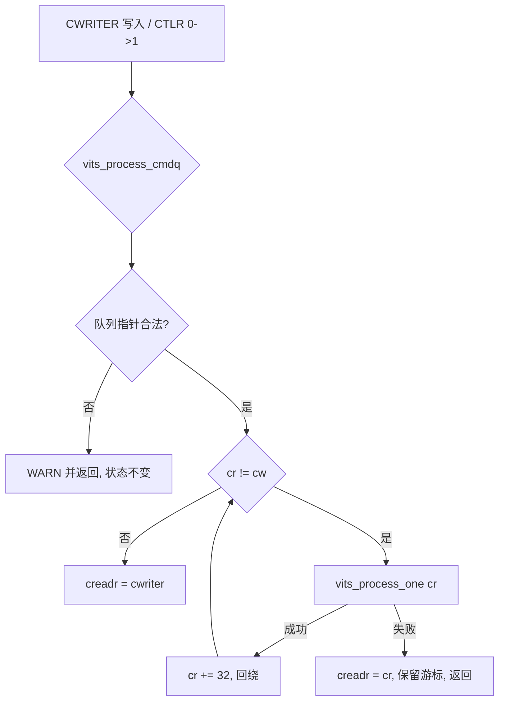
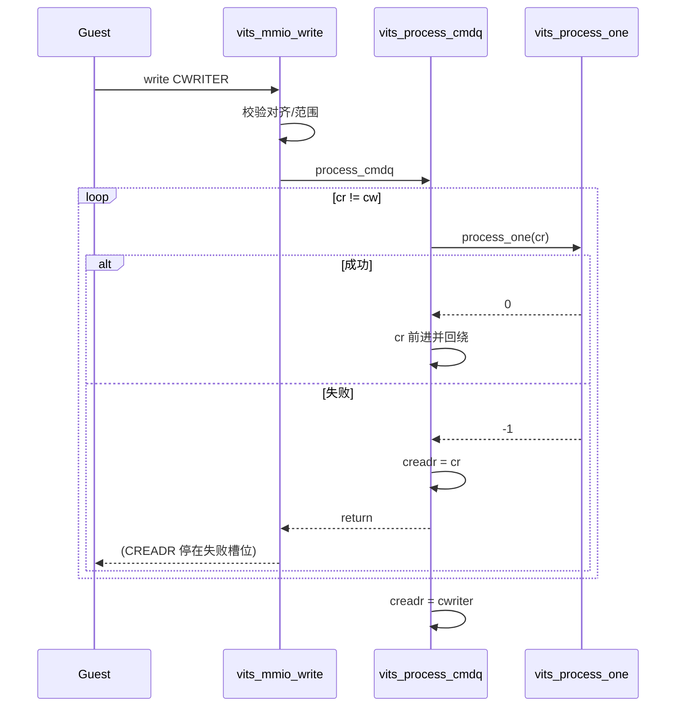

# aVisor Phase 143 详细设计：vITS 命令失败停止与 CREADR 保留

> 平台：QEMU virt / AArch64 EL2 / GICv3 ITS + vITS
> 前置阶段：Phase 142 全局 LPI 影子映射同步
> 本阶段目标：把 vITS 命令队列的失败语义从「告警后跳过」改为「失败即停止并保留 CREADR」。

## 1. 背景

`vits_process_cmdq()` 从 CREADR 遍历到 CWRITER 逐条执行命令。Phase 139 之后，命令读取已做 cache invalidate，队列内存可见性得到保证；Phase 140 之后，per-vITS MMIO 访问已串行化。但命令**执行结果**的处理仍是乐观的：

```c
while (cr != cw) {
    if (vits_process_one(vits, cr) < 0)
        WARN("vITS: command at 0x%lx failed; advancing CREADR", ...);
    cr += VITS_CMD_SIZE;
}
vits->creadr = cw;
```

失败命令只打印告警，游标继续前进，循环结束后无条件把 CREADR 推到 CWRITER。后果是：一条被拒绝的命令（例如未拥有 requester 的 MAPTI、读命令失败）会被当作已完成，队列的后续命令在其后继续执行，而 Guest 通过 CREADR 看到的是「全部命令都已处理」。

这与 GICv3 ITS 的模型不符。真实 ITS 在命令执行出错时不会凭空推进消费游标，Guest 依赖 CREADR 判断命令是否真正落地。更重要的是：MAPTI 的失败意味着 route/shadow 没有建立，如果队列继续推进，后续 SYNC 和依赖该映射的命令会在一个「看似成功」的队列状态下执行，错误被静默吞掉。

## 2. 目标与非目标

目标：

- 单条命令执行失败时立即终止本轮队列处理；
- CREADR 停留在失败命令的槽位偏移，不推进到 CWRITER；
- 失败之后的命令在本轮不被执行；
- 保持既有队列指针合法性校验（Phase 132/138）不变；
- Guest 侧增加对 fail-stop 语义的回归覆盖，并给出可恢复路径。

非目标：改变单条命令的判定条件（ownership、MAPTI 事务、物理 ITS 完成确认）、新增命令类型、修改 CWRITER 合法性规则、为失败命令引入自动重试或自动跳过。

## 3. 架构



失败路径是一条早退出口，与「队列清空」出口互斥。二者是仅有的两个更新 CREADR 的位置。

## 4. 详细设计

### 4.1 失败即停止

`vits_process_one()` 的返回值语义保持不变：`< 0` 表示该条命令未被接受。当前产生失败的路径有两条：

- `vits_read_cmd()` 读取失败（越界或指针非法）；
- `vits_cmd_mapti()` 返回失败（ownership 校验、irq-domain 注册失败、物理 ITS 命令发送失败、post-publish audit 失败等）。

`vits_process_cmdq()` 在收到失败时：

1. 打印 `command at 0x%lx failed; halting, CREADR retained`；
2. 把 `vits->creadr` 显式写为失败命令的偏移 `cr`；
3. 直接 `return`，不再推进 `cr`，不再执行剩余命令。

显式写入 CREADR 而不是依赖「循环未执行到末尾赋值」，是为了让失败语义在代码上自证：无论后续如何重构循环，失败出口都必须留下游标。

### 4.2 重试语义

由于 CREADR 停在失败槽位，下一次 `vits_process_cmdq()` 会从同一条命令重新开始。触发入口有两个：

- Guest 再次写 CWRITER（`VITS_CWRITER` 分支在 enabled 状态下调用 `vits_process_cmdq()`）；
- Guest 写 CTLR 由 0 变 1（Phase 137 的 enable drain 路径）。

这意味着失败命令会被反复尝试，直到 Guest 修复导致失败的前置条件，或用 CBASER 重建队列。这是有意的：fail-stop 的语义是「队列停在这里」，而不是「丢弃这条命令」。丢弃会让 Guest 的 CREADR 与真实执行状态永久不一致，而这正是本阶段要消除的问题。

### 4.3 Guest 可恢复路径

失败命令不可跳过，Guest 需要一个显式的复位手段。既有寄存器语义已提供该路径：

1. 写 `CTLR = 0` 禁用 vITS；
2. 写 `CBASER`（Phase 134 规定 enabled 时拒绝，disabled 时接受），该分支会把 `cwriter` 和 `creadr` 同时清零；
3. 写 `CTLR = 1` 重新使能。

整个过程不引入新寄存器，也不放宽 CBASER 的 enabled 保护。

### 4.4 Guest 回归测试调整

`vits_test()` 中新增/修正两处：

- **写指针同步**：pending-queue 测试直接写 `CWRITER=0x20` 并让 enable drain 消费，但 Guest 软件侧的 `vits_cwriter` 仍为 0。后续命令会写到槽位 0，与硬件读取的 0x20 错位。修正为在该测试后同步 `vits_cwriter = 0x20`。
- **fail-stop 断言**：把「未拥有 requester 的 MAPTI」改为显式构造并断言：
  - 提交后 `CREADR == 失败命令偏移`（未被推进）；
  - 通过 `CTLR 0 -> CBASER 重写 -> CTLR 1` 复位队列，断言 `CREADR == CWRITER == 0`；
  - 复位后继续执行正常 MAPTI，验证队列可用。

该负向用例的位置被提前，使它在队列复位后不影响后续正向流程。原先「未拥有 requester 的 MAPTI」夹在正常命令之间，在推进语义下无副作用，在 fail-stop 语义下会阻塞其后的所有命令，因此必须显式复位。

## 5. 调用图



## 6. 不变量

| 不变量 | 保证方式 |
|---|---|
| CREADR 永不越过未成功执行的命令 | 失败路径显式写 `creadr = cr` 后返回 |
| 失败后本轮不再执行任何后续命令 | 失败出口为 `return`，跳过循环 |
| 成功路径语义不变 | 循环正常结束时仍执行 `creadr = cwriter` |
| CREADR 只被两个出口修改 | 清空出口与失败出口，无第三处赋值 |
| 队列指针非法时不改变 CREADR | 前置校验分支直接返回，未进入循环 |
| 失败命令不丢失 | CREADR 保留在槽位，下次触发重新执行 |
| CBASER 保护不被放宽 | 复位路径要求先 `CTLR=0`，沿用 Phase 134 校验 |

## 7. 错误处理

- `vits_process_one()` 读命令失败：停止，CREADR 保留在读取失败的槽位；
- MAPTI 被所有权校验拒绝：停止，不发布 route/shadow，CREADR 保留；
- MAPTI 物理命令或 audit 失败：停止，回滚由 MAPTI 事务内部完成（Phase 131/142），CREADR 保留；
- 未知 opcode：仍只告警并继续（当前判定为「已消费但不支持」，不属于失败）。该行为本阶段未改变，作为已知限制记录；
- 队列指针非法：Phase 132/138 的告警路径不变，不修改任何队列状态。

## 8. 验证

- `make -B -f Makefile.virt -j2`：通过；
- IDE diagnostics：`vits.c` 无诊断；
- `git diff --check`：通过；
- QEMU（35 秒 timeout，退出码 124，属测试窗口结束）：日志确认
  - `MAPTI rejected for unowned requester 17` 后出现 `command at 0x80 failed; halting, CREADR retained`；
  - Guest 断言输出 `vITS: unowned MAPTI halted queue, CREADR retained`；
  - `CTLR=0` → `CBASER` 重写 → `CTLR=1` 后输出 `vITS: queue reset after halt`；
  - 后续 `MAPTI devid=16 eventid=2/1` 分别得到 pLPI 9000/9001，`vITS: PASSED! Received vSPI 72 (vLPI 8200)`；
  - 回归中该路径不再出现 `vITS: command timeout!`。

未覆盖：没有针对「失败后多 vCPU 并发重试」的压力测试，也没有对 `vits_read_cmd()` 读取失败路径注入故障。

## 9. 限制

- 失败命令会阻塞队列，直到 Guest 显式复位；这是有意的语义选择，但与「尽力推进」的实现相比，对 Guest 的命令构造正确性要求更高。
- 未知 opcode 仍被静默消费，与失败命令的处理不一致；若后续需要，可单独阶段化。
- 复位手段依赖 CBASER 重建，Guest 会丢失队列中尚未执行的命令；当前测试场景下队列为空，未验证非空队列复位后的行为。
- 本阶段不引入失败计数或诊断寄存器，故障信息只通过串口 WARN 呈现。

## 10. 文件映射

| 文件 | 职责 |
|---|---|
| `hypervisor/boards/virt/vits.c` | `vits_process_cmdq()` 失败早退与 CREADR 保留 |
| `guests/el1_test/main.c` | 写指针同步、fail-stop 断言与队列复位回归 |
| 本文件 | 语义、状态机、调用图、不变量与验证边界 |

## 11. 总结

Phase 143 把 vITS 命令队列的失败处理从「告警后推进」改为「停止并保留 CREADR」，使 Guest 观察到的消费进度与真实执行结果一致。失败命令不再被静默跨越，其后的命令不会在错误的队列状态下执行。Guest 侧通过显式断言覆盖停止与复位两条路径，并用既有 CTLR/CBASER 语义完成恢复，不新增寄存器、不放宽已有校验。
