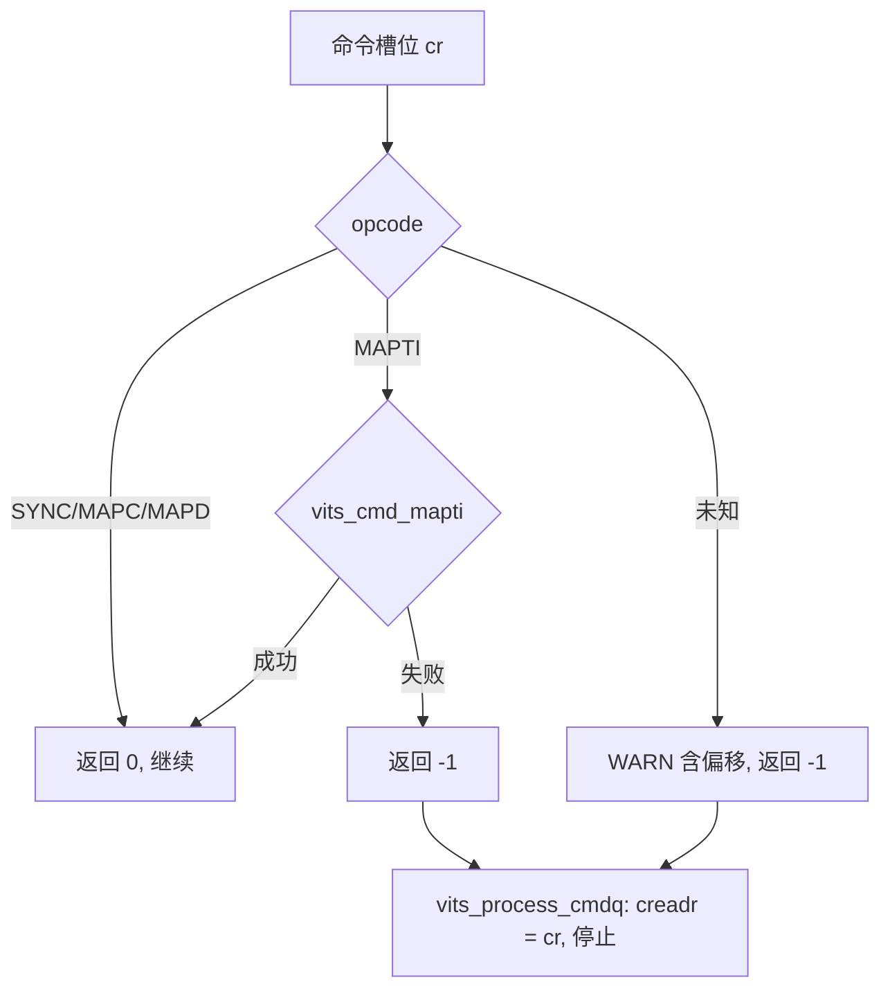
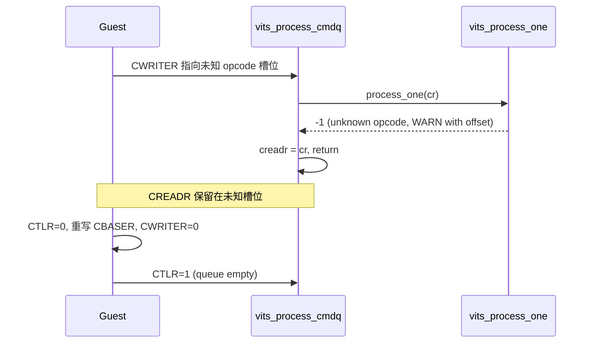

# aVisor Phase 144 详细设计：vITS 未知命令按失败停止处理

> 平台：QEMU virt / AArch64 EL2 / GICv3 ITS + vITS
> 前置阶段：Phase 143 命令失败即停止并保留 CREADR
> 本阶段目标：未知 opcode 不再被静默消费，改为与其它命令失败相同的 fail-stop 语义。

## 1. 背景

Phase 143 之后，`vits_process_cmdq()` 对任何 `vits_process_one()` 返回负值的命令都停止处理并保留 CREADR。但 `vits_process_one()` 的 `default` 分支（未知 opcode）仍然只打印 WARN 并返回 0。结果是：

- 未知 opcode 的槽位被当作已完成，CREADR 越过该槽位继续推进；
- Guest 通过 CREADR 看到的消费进度与真实执行不一致；
- 同一队列中，未知命令与 MAPTI 拒绝两种「无法执行」情形得到不同处理，语义不统一。

Phase 143 文档已把这一不一致列为已知限制。

## 2. 目标与非目标

目标：

- 未知 opcode 返回失败，由 `vits_process_cmdq()` 统一停止；
- CREADR 停留在未知命令的槽位偏移；
- WARN 文本包含偏移，便于定位；
- Guest 回归覆盖：提交未知 opcode 后 CREADR 不前进，再经 CTLR/CBASER 复位恢复。

非目标：实现新的 opcode（INV、INVALL、MOVI 等）、改变已知命令的处理、为未知命令增加跳过或计数寄存器。

## 3. 架构

未知 opcode 与 MAPTI 失败汇入同一条停止出口，不再有独立的消费分支。

## 4. 详细设计

### 4.1 vits_process_one()

`default` 分支由「WARN + break」改为「WARN（含 offset）+ return -1」。不猜测未知命令的语义，也不把其视为 NOP。

### 4.2 vits_process_cmdq()

无需修改。Phase 143 的失败出口已经能够处理任意 `< 0` 返回。

### 4.3 Guest 回归

`vits_test()` 中在 Phase 143 的 MAPTI 复位之后增加：

1. 在当前 `vits_cwriter` 位置写入 opcode `0x7F` 的槽位；
2. 提交 CWRITER，断言 CREADR 停在该槽位；
3. 通过 `CTLR 0 -> CBASER 重写 -> CTLR 1` 复位，断言 CREADR == CWRITER == 0。

## 5. 调用图

## 6. 不变量

| 不变量 | 保证方式 |
|---|---|
| 未知 opcode 不被静默消费 | default 分支返回负值 |
| CREADR 不越过未知槽位 | 复用 Phase 143 的失败出口 |
| 已知命令行为不变 | 仅修改 default 分支 |
| 复位路径不放宽 CBASER 保护 | 沿用 Phase 134 的 CTLR=0 前置条件 |

## 7. 错误处理

- 未知 opcode：停止，CREADR 保留，WARN 输出 opcode 与偏移；
- 恢复：仅通过 CTLR/CBASER 复位，队列中其后的命令不会被执行。

## 8. 验证

- `make -B -f Makefile.virt -j2`：通过；
- `git diff --check`：通过；
- IDE diagnostics：`vits.c` 无诊断；
- QEMU（35 秒 timeout，退出码 124，属测试窗口结束）：
  - 日志确认 `unknown command opcode 0x7f at offset 0x0` 后 `command at 0x0 failed; halting, CREADR retained`；
  - Guest 输出 `vITS: unknown opcode halted queue, CREADR retained`；
  - 复位后 MAPTI 与 MSI 测试仍得到 `PASSED! Received vSPI 72`；
  - 未出现 `vITS: command timeout!`。

已知测试偏差：Guest 在复位后 `vits_cwriter` 归零，未知命令因此写在偏移 0x0，而非队列中部。这验证了 fail-stop 的行为，但未覆盖「非零偏移处的未知命令」。

## 9. 限制

- 未知 opcode 现在阻塞队列，与真实 ITS 的 command error 行为接近，但真实硬件会上报 ITS 错误状态寄存器，本实现只有串口 WARN；
- 未覆盖非零偏移的未知命令，以及未知命令之后紧跟有效命令的场景；
- 未实现 INV/INVALL 等未覆盖的已知 opcode，它们仍被视为未知并停止队列。

## 10. 文件映射

| 文件 | 职责 |
|---|---|
| `hypervisor/boards/virt/vits.c` | 未知 opcode 返回失败 |
| `guests/el1_test/main.c` | 未知 opcode fail-stop 与复位回归 |
| 本文件 | 语义、调用图、不变量与验证边界 |

## 11. 总结

Phase 144 把未知 opcode 纳入与 MAPTI 拒绝相同的 fail-stop 出口。队列不再越过无法识别的命令，Guest 通过既有 CTLR/CBASER 路径复位。改动范围限于 `default` 分支与一段回归测试。
