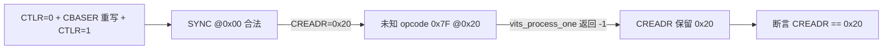
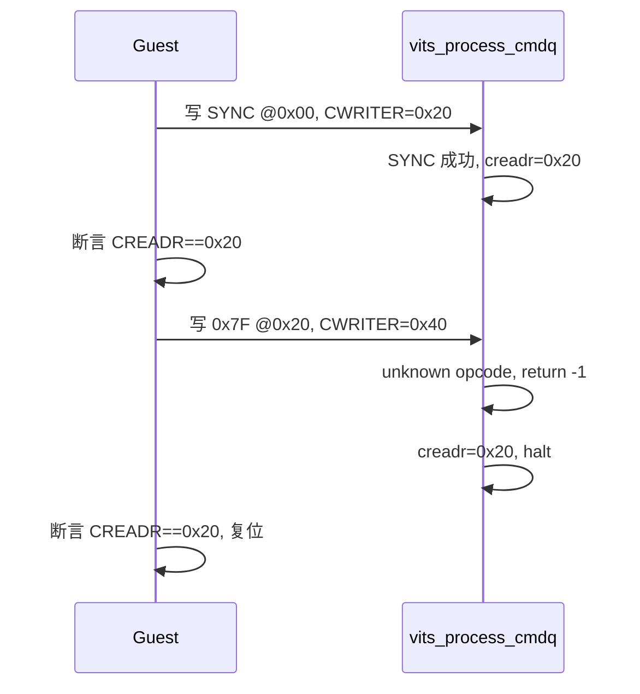

# aVisor Phase 145 详细设计：vITS 非零偏移未知命令回归

> 平台：QEMU virt / AArch64 EL2 / GICv3 ITS + vITS
> 前置阶段：Phase 144 未知 opcode 按失败停止处理
> 本阶段目标：修复 Phase 144 的测试偏差，使未知 opcode 的 fail-stop 在队列非零偏移处被覆盖。

## 1. 背景

Phase 144 把未知 opcode 纳入 fail-stop 出口，但 Guest 回归把未知命令写在复位后的偏移 0x0。该位置只说明「队列从头开始时」的行为，无法区分：

- 第一条命令失败时的停止；
- 队列中部（已有合法命令被消费之后）失败时的停止。

后者才能验证 CREADR 是否真正停在失败槽位，而不是回到队列起点。

## 2. 目标与非目标

目标：

- 复位后先消费一条合法 SYNC，使队列推进到 0x20；
- 在 0x20 写入未知 opcode 0x7F，断言 CREADR 停在 0x20；
- 日志确认 WARN 偏移为 0x20。

非目标：修改 hypervisor 行为（Phase 144 的语义保持不变）；新增 opcode；覆盖未知命令之后紧跟有效命令的场景。

## 3. 架构

## 4. 详细设计

### 4.1 Guest 回归（guests/el1_test/main.c）

在 Phase 144 的复位之后：

1. 在当前 `vits_cwriter`（0x00）写入 `ITS_CMD_SYNC`，推进 CWRITER 到 0x20；
2. 断言 CREADR == 0x20，证明 SYNC 被消费；
3. 在 0x20 写入 opcode `0x7F`，推进 CWRITER 到 0x40；
4. 断言 CREADR == 0x20（unk_slot），并且 `unk_slot != 0`；
5. 复位路径不变：`CTLR=0 → CBASER 重写 → CTLR=1`，断言 CREADR == CWRITER == 0。

### 4.2 hypervisor

无改动。`vits_process_one()` 的 `default` 分支与 `vits_process_cmdq()` 的 fail-stop 出口沿用 Phase 144。

## 5. 调用图

## 6. 不变量

| 不变量 | 保证方式 |
|---|---|
| 合法 SYNC 在非零偏移前被消费 | 断言 CREADR == 0x20 |
| 未知 opcode 不被消费 | 断言 CREADR 停在 0x20 |
| 失败偏移可被定位 | WARN 含 offset 0x20 |
| 复位后队列回到起点 | 断言 CREADR == CWRITER == 0 |

## 7. 验证

- `make -B -f Makefile.virt -j2`：通过；
- `git diff --check`：通过；
- QEMU（35 秒 timeout，退出码 124，属测试窗口结束）：
  - `unknown command opcode 0x7f at offset 0x20`；
  - `command at 0x20 failed; halting, CREADR retained`；
  - Guest 输出 `vITS: unknown opcode halted queue, CREADR retained`；
  - 后续 MAPTI 与 MSI 仍得到 `PASSED! Received vSPI 72`。

## 8. 限制

- SYNC 本身没有可观测副作用，只能通过 CREADR 推进间接确认被消费；
- 未覆盖未知命令之后紧跟有效命令的场景（应断言该有效命令不被执行）；
- 未实现真实 ITS 的错误状态寄存器上报，失败只有串口 WARN；
- `edu function reset FAILED` 仍在后段出现，属既有问题。

## 9. 文件映射

| 文件 | 职责 |
|---|---|
| `guests/el1_test/main.c` | 非零偏移 SYNC 推进与未知 opcode 回归 |
| 本文件 | 目标、调用图、不变量与验证边界 |

## 10. 总结

Phase 145 把未知 opcode fail-stop 的回归从队列起点移到非零偏移 0x20，消除 Phase 144 的测试偏差。hypervisor 行为不变，改动仅限 Guest 回归。
