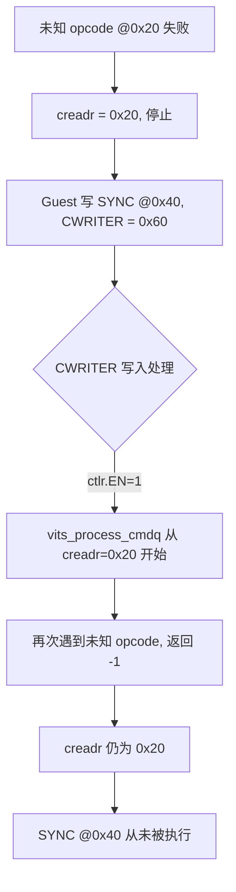
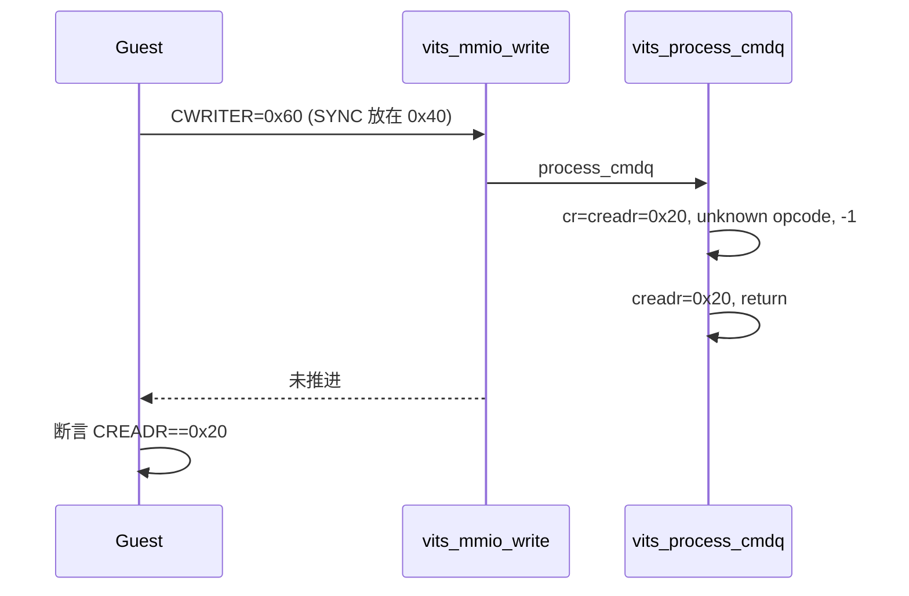

# aVisor Phase 146 详细设计：vITS 停止后追加命令不得执行

> 平台：QEMU virt / AArch64 EL2 / GICv3 ITS + vITS
> 前置阶段：Phase 145 非零偏移未知命令回归
> 本阶段目标：验证 fail-stop 之后追加的合法命令不会被消费，并记录「再次写 CWRITER 会重放失败槽位」这一真实行为。

## 1. 背景

Phase 143–145 已确立并验证 fail-stop：某条命令失败后，`vits_process_cmdq()` 停止本轮处理，`creadr` 停在失败槽位。但此前所有回归只在「停止即结束」的形态下检查 CREADR，没有覆盖 Guest 在停止后继续追加命令、再次推进 CWRITER 的情形。

这一情形在真实 Guest 驱动中很常见：驱动通常不会检查 CREADR 就继续提交命令。因此需要确认：

1. 追加的合法命令不会被静默执行；
2. CREADR 不会因新的 CWRITER 写入而越过失败槽位。

## 2. 目标与非目标

目标：

- 在未知 opcode 造成的停止之后，于下一个槽位写入合法 SYNC 并推进 CWRITER；
- 断言 CREADR 仍等于失败槽位（0x20），即 SYNC 未被执行；
- 记录再次写 CWRITER 会从 CREADR 重放失败槽位的实际行为。

非目标：修改 hypervisor 语义；改变 CWRITER 写入的触发条件；为停止状态增加专门的「已停止」寄存器位。

## 3. 架构

关键点：`vits_process_cmdq()` 的起点始终是 `creadr`，不是上一次的 `cwriter`。因此失败槽位会被重复访问，而它之后的命令永远无法到达。

## 4. 详细设计

### 4.1 Guest 回归（guests/el1_test/main.c）

在 `vITS: unknown opcode halted queue, CREADR retained` 之后：

1. 在 `vits_cwriter`（0x40）写入 `ITS_CMD_SYNC`；
2. 推进 `vits_cwriter` 到 0x60 并写 CWRITER；
3. 断言 CREADR == `unk_slot`（0x20）；
4. 输出 `valid command after halt not executed`。

随后沿用既有复位路径：`CTLR=0 → CBASER 重写 → CTLR=1`。

### 4.2 hypervisor

无改动。`VITS_CWRITER` 写入在 `vits->ctlr & 0x1` 时调用 `vits_process_cmdq()`，而该函数从 `vits->creadr` 开始遍历——这正是追加命令不被执行的原因。

## 5. 调用图

## 6. 不变量

| 不变量 | 保证方式 |
|---|---|
| 停止后 CREADR 不被新 CWRITER 越过 | `vits_process_cmdq()` 从 `creadr` 起步 |
| 追加的合法命令不执行 | 断言 CREADR == 失败槽位 |
| 失败槽位可重复访问但不前进 | 日志中重复出现同一 offset 的 WARN |
| 复位路径不变 | 沿用 CTLR/CBASER |

## 7. 一次真实失败记录

首次实现把断言写成 `CREADR == vits_cwriter`（追加位置 0x40），QEMU 报 `FAILED (valid command executed after halt)`。查证后确认断言本身错误：CREADR 正确地停在 0x20。修正比较值为 `unk_slot` 后通过。该次失败反而验证了「再次写 CWRITER 不会越过失败槽位」——否则 CREADR 会变成 0x40 或 0x60。

## 8. 验证

- `make -B -f Makefile.virt -j2`：通过；
- `git diff --check`：通过；
- QEMU（35 秒 timeout，退出码 124，属测试窗口结束）：
  - `unknown command opcode 0x7f at offset 0x20` 出现两次（重放）；
  - `command at 0x20 failed; halting, CREADR retained` 出现两次；
  - Guest 输出 `valid command after halt not executed`；
  - 后续 MAPTI 与 MSI 仍 `PASSED! Received vSPI 72`。

## 9. 限制

- 停止状态没有独立的软件标志位，每次 CWRITER 写入都会重放失败槽位并重复 WARN，日志噪声随 Guest 提交频率增长；
- 没有覆盖合法命令失败（MAPTI 拒绝）后追加命令的同类场景，逻辑上相同但未单独断言；
- 未实现真实 ITS 的错误状态寄存器；
- `edu function reset FAILED` 仍在后段出现，属既有问题。

## 10. 文件映射

| 文件 | 职责 |
|---|---|
| `guests/el1_test/main.c` | 停止后追加命令的回归断言 |
| 本文件 | 行为语义、调用图、不变量与验证边界 |

## 11. 总结

Phase 146 补齐了 fail-stop 最容易被忽略的一面：停止之后 Guest 继续提交命令时，hypervisor 既不会执行它们，也不会让 CREADR 越过失败点。代价是失败槽位被反复重放，这一点记入限制，作为后续阶段（显式停止标志或去重告警）的输入。
