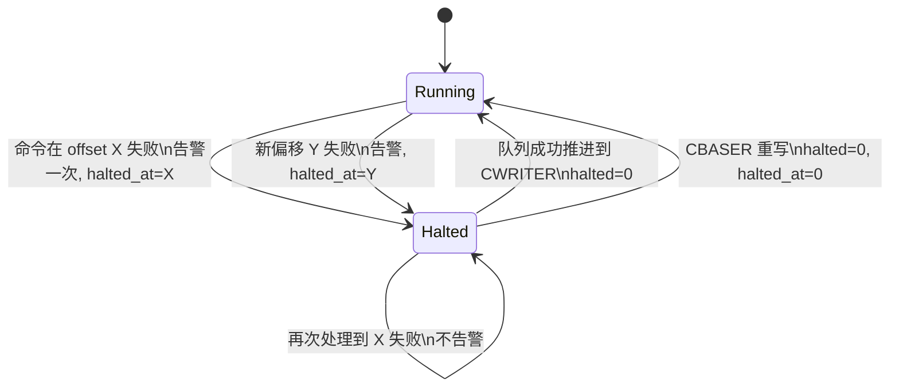
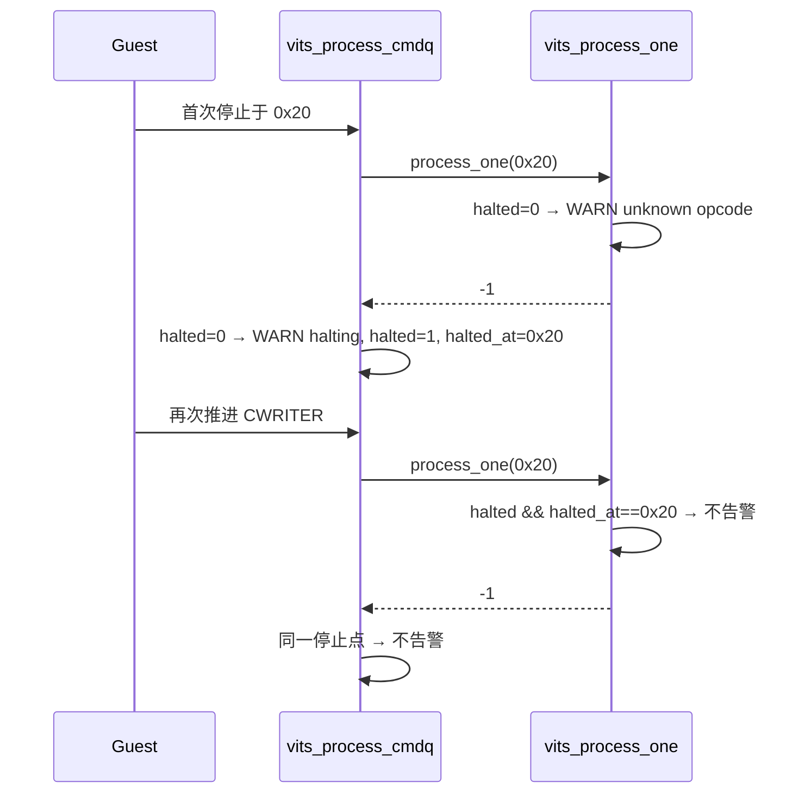

# aVisor Phase 147 详细设计：vITS fail-stop 重复告警去重

> 平台：QEMU virt / AArch64 EL2 / GICv3 ITS + vITS
> 前置阶段：Phase 146 停止后追加命令不得执行
> 本阶段目标：同一失败停止点被 Guest 反复推进 CWRITER 时，只告警一次。

## 1. 背景

Phase 146 验证了停止后追加命令不会被执行，但日志暴露了副作用：每次 CWRITER 写入都会从 CREADR 重新遍历，于是失败槽位被重新执行，同一条 WARN 反复输出。这同时影响两处：

- `vits_process_cmdq()` 的 `command at 0x%lx failed; halting` 告警；
- `vits_process_one()` 的 `unknown command opcode` 告警。

重复告警不改变语义，但会淹没真正的新故障。

## 2. 目标与非目标

目标：

- 增加停止状态记录（`halted`、`halted_at`）；
- 同一偏移重复失败时不再告警；
- 队列成功前进或 CBASER 复位时清除停止状态；
- 不改变 CREADR 语义、不改变 CWRITER 重放行为（Phase 146 的断言保持有效）。

非目标：阻止重放（选择「完全冻结」被用户否决）；去重 MAPTI 拒绝的告警（其路径与 opcode 路径分开，本阶段未修改）。

## 3. 架构

## 4. 详细设计

### 4.1 状态字段（include/boards/virt/vits.h）

`struct vits_state` 增加：

- `uint64_t halted_at`：最近一次失败的偏移；
- `uint8_t halted`：是否处于停止状态。

### 4.2 vits_process_cmdq()

失败分支仅在 `!halted || halted_at != cr` 时告警，随后记录 `halted=1, halted_at=cr`。无论是否告警，都保持 `creadr = cr` 并返回。

成功完成循环后清除 `halted`，再 `creadr = cw`。

### 4.3 vits_process_one()（unknown opcode）

`default` 分支的 WARN 同样受 `halted && halted_at == offset` 抑制。该判断依赖 `vits_process_cmdq()` 在失败后写入的 `halted` 状态：首次失败时 `halted` 尚为 0，会告警；随后 `vits_process_cmdq()` 记录状态，重放时抑制。

### 4.4 CBASER 写入

复位（CBASER 重写且 CTLR 失能）时同时清除 `halted` 与 `halted_at`，保证复位后的第一次失败会重新告警。

### 4.5 MAPTI 拒绝路径

未修改。它在 `vits_process_one()` 内直接 WARN，目前仍会在重放时重复输出，记入限制。

## 5. 调用图

## 6. 不变量

| 不变量 | 保证方式 |
|---|---|
| 同一停止点至多一次 halting WARN | `halted && halted_at == cr` 判断 |
| 同一未知 opcode 至多一次 WARN | `process_one` 内同样判断 |
| 新故障必然告警 | 偏移不同或已清除状态时告警 |
| 停止状态在复位后清除 | CBASER 写入清零 |
| 语义不变 | CREADR 仍停在失败槽位，追加命令不执行 |

## 7. 验证

- `make -B -f Makefile.virt -j2`：通过；`main.c` 三个 unused variable 警告为既有问题，非本阶段引入；
- `git diff --check`：通过；
- IDE diagnostics（`vits.c`）：无诊断；
- QEMU（35 秒 timeout，退出码 124，属测试窗口结束）：
  - `unknown command opcode 0x7f at offset 0x20`：1 次（Phase 146 中为 2 次）；
  - `command at 0x20 failed; halting`：1 次（Phase 146 中为 2 次）；
  - `valid command after halt not executed`：通过；
  - 后续 `PASSED! Received vSPI 72`：通过。

## 8. 限制

- MAPTI 拒绝路径的告警仍会在重放时重复输出，未去重；
- 去重依赖偏移比较，若 Guest 在失败后通过 CBASER 复位，状态被清除，属预期；
- 停止状态不对 Guest 可见（没有 GITS 状态寄存器位），软件侧只做告警抑制；
- 真实 ITS 的错误状态上报仍未实现；
- `edu function reset FAILED` 仍在后段出现，属既有问题；
- `main.c` 中既有的 unused variable 警告未处理。

## 9. 文件映射

| 文件 | 职责 |
|---|---|
| `include/boards/virt/vits.h` | `halted`、`halted_at` 字段 |
| `hypervisor/boards/virt/vits.c` | 停止点去重、成功清除、CBASER 复位清除 |
| 本文件 | 状态机、调用图、不变量与验证 |

## 10. 总结

Phase 147 把停止状态从「仅 CREADR」扩展为「CREADR + 已告警的停止点」。同一故障在队列被反复推进时只告警一次，新故障或复位后的故障仍会告警。语义与 Phase 146 完全一致。
