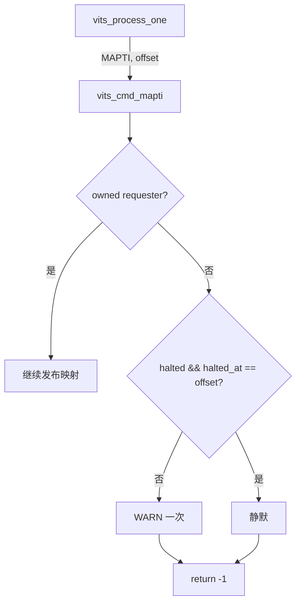
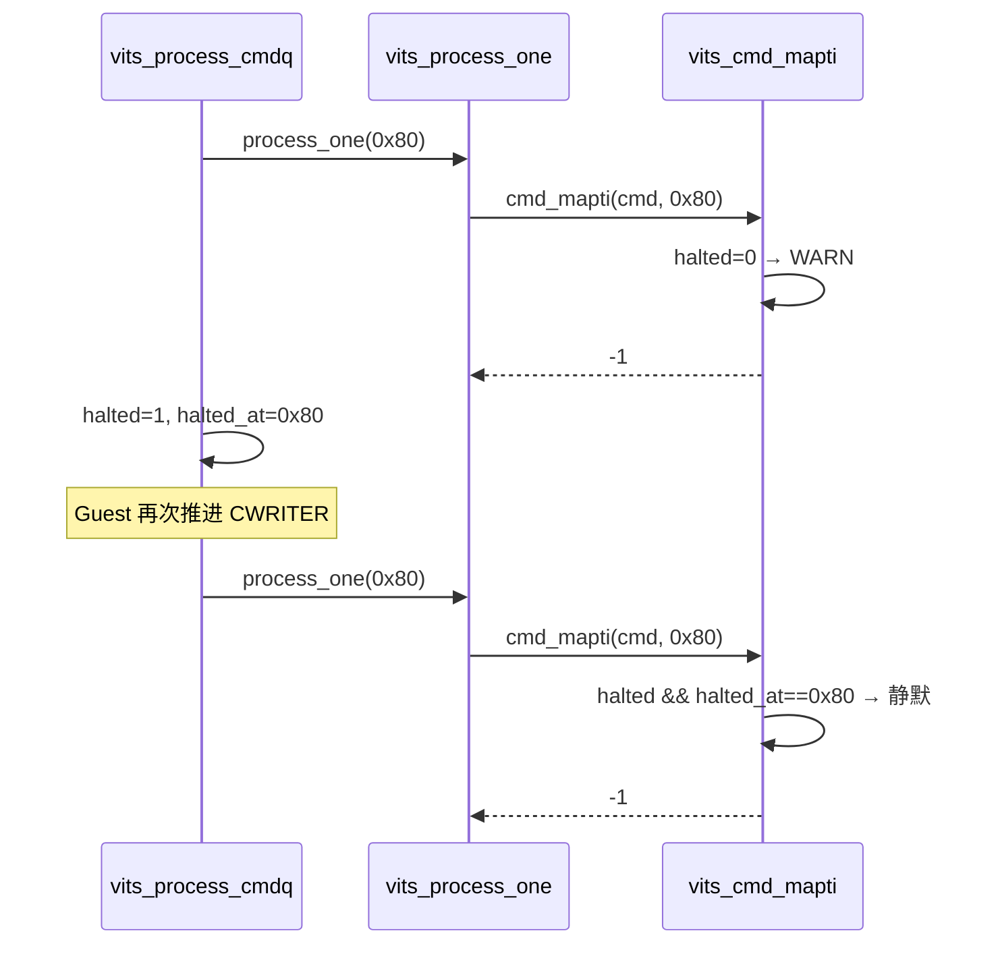

# aVisor Phase 148 详细设计：MAPTI 拒绝告警纳入 fail-stop 去重

> 平台：QEMU virt / AArch64 EL2 / GICv3 ITS + vITS
> 前置阶段：Phase 147 fail-stop 重复告警去重
> 本阶段目标：把 Phase 147 留下的 MAPTI「未拥有 requester」拒绝告警纳入同一去重规则。

## 1. 背景

Phase 147 只对两类告警做了去重：`command ... failed; halting` 与 `unknown command opcode`。`vits_cmd_mapti()` 在 requester 不属于 VM1 时也会直接 WARN，但这条路径没有纳入去重。它的重放条件与 opcode 路径相同：Guest 在 fail-stop 后再次推进 CWRITER，CREADR 从失败槽位重新处理同一条 MAPTI。

因此，即便当前 Guest 回归中该告警只出现一次，只要 Guest 反复推进 CWRITER，它就会重复输出。

## 2. 目标与非目标

目标：

- `vits_cmd_mapti()` 接收命令偏移；
- 与 opcode 路径相同，仅当 `!halted || halted_at != cmd_offset` 时告警；
- 语义保持不变：仍返回 -1，CREADR 仍停在失败槽位。

非目标：修改 MAPTI 的拒绝条件；修改其它 WARN（如 `no free physical LPI`、`physical MAPTI failed`）；这些属于成功路径内的一次性故障，本阶段不去重。

## 3. 架构



## 4. 详细设计

### 4.1 函数签名

`vits_cmd_mapti(struct vits_state *vits, uint64_t cmd[4], uint64_t cmd_offset)`。调用点 `vits_process_one()` 传入 `offset`。

### 4.2 拒绝分支

```c
if (!vits->halted || vits->halted_at != cmd_offset)
    WARN("vITS: MAPTI rejected for unowned requester %u", vdevid);
return -1;
```

返回值与 Phase 147 之前完全一致。

### 4.3 去重依赖

`halted` 与 `halted_at` 由 `vits_process_cmdq()` 在首次失败时写入（Phase 147）。因此首次拒绝仍然告警，后续重放在同一偏移上静默。

## 5. 调用图



## 6. 不变量

| 不变量 | 保证方式 |
|---|---|
| 未拥有 requester 的 MAPTI 不发布映射 | 拒绝分支返回 -1，不进入后续发布逻辑 |
| 首次拒绝必然告警 | halted 初始为 0 或偏移不同 |
| 重放拒绝不重复告警 | halted && halted_at == offset |
| CREADR 语义不变 | 仍由 vits_process_cmdq 停在失败槽位 |

## 7. 验证

- `make -B -f Makefile.virt -j2`：通过；
- `git diff --check`：通过；
- IDE diagnostics（`vits.c`）：无诊断；
- QEMU（35 秒 timeout，退出码 124，属测试窗口结束）：
  - `MAPTI rejected for unowned requester 17`：1 次；
  - `command at 0x80 failed; halting, CREADR retained`：1 次；
  - `valid command after halt not executed`：通过；
  - 后续 `PASSED! Received vSPI 72`：通过。

验证边界：当前 Guest 回归在 MAPTI 拒绝后只复位、不对同一偏移重放，因此本阶段的去重分支在 QEMU 中没有被显式触发。它的正确性由与 Phase 147 相同的判断逻辑保证，但未单独构造「MAPTI 拒绝 + 重放」的回归用例。

## 8. 限制

- 去重分支未被当前回归直接覆盖，属于逻辑对称推断，应在后续阶段补充专门的重放用例；
- 其它成功路径内的 WARN（`no free physical LPI`、`LPI ownership registration failed`、`physical MAPTI failed`）仍不去重；
- 停止状态对 Guest 不可见，只做软件侧告警抑制；
- `edu function reset FAILED` 仍在后段出现，属既有问题；
- `main.c` 既有 unused variable 警告未处理。

## 9. 文件映射

| 文件 | 职责 |
|---|---|
| `hypervisor/boards/virt/vits.c` | `vits_cmd_mapti()` 增加偏移参数与去重判断 |
| 本文件 | 去重范围、调用图、不变量与验证边界 |

## 10. 总结

Phase 148 把 Phase 147 的去重规则扩展到 MAPTI 拒绝路径，使三类拒绝/失败告警（opcode、命令失败停止、MAPTI 未拥有 requester）统一遵循「同一停止点只告警一次」。返回值与 CREADR 语义保持不变。
