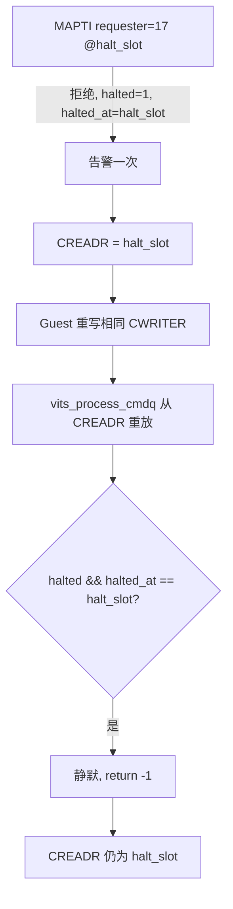
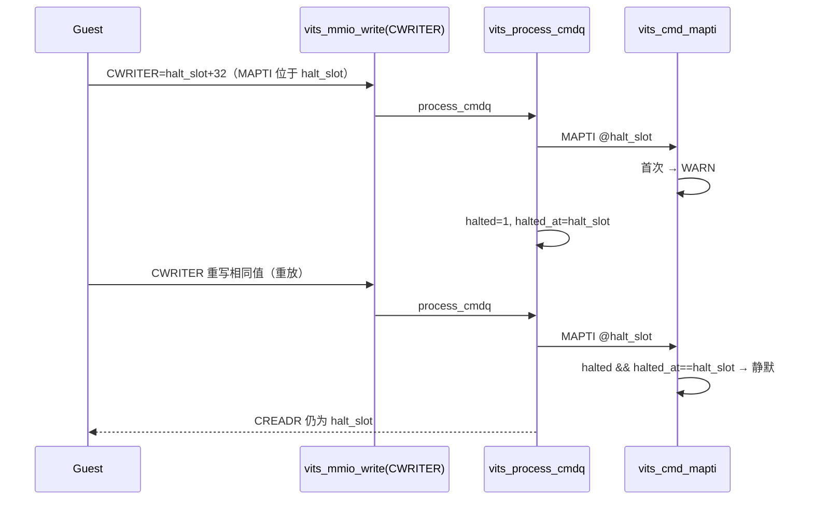

# aVisor Phase 149 详细设计：MAPTI 拒绝重放去重回归

> 平台：QEMU virt / AArch64 EL2 / GICv3 ITS + vITS
> 前置阶段：Phase 148 MAPTI 拒绝告警纳入去重
> 本阶段目标：用真实重放验证 Phase 148 的去重分支，补齐其验证边界。

## 1. 背景

Phase 148 把 `vits_cmd_mapti()` 的未拥有 requester 拒绝告警纳入 `halted && halted_at == cmd_offset` 去重，但文档承认：当前 Guest 回归在 MAPTI 拒绝后立即复位，从未在同一偏移重放，因此去重分支没有被 QEMU 实际触发。

本阶段补上这一缺口。

## 2. 目标与非目标

目标：

- 在 MAPTI 拒绝、CREADR 停在 `halt_slot` 之后，Guest 重写相同 CWRITER，强制从 CREADR 重放；
- 断言 CREADR 仍等于 `halt_slot`；
- 通过日志计数确认 `MAPTI rejected` 只告警一次，而 `MAPTI vdevid=17` 的处理发生两次（即确实重放）。

非目标：修改 hypervisor 代码（Phase 148 的去重逻辑保持不变）；为 Guest 增加读取 WARN 的接口（告警只能通过串口日志观察）。

## 3. 架构

## 4. 详细设计

### 4.1 Guest 回归（guests/el1_test/main.c）

在 `vITS: unowned MAPTI halted queue, CREADR retained` 之后：

1. 再次写入 `vits_cwriter`（与当前相同的值）；
2. 断言 `CREADR == halt_slot`；
3. 输出 `vITS: MAPTI replay kept halt point`。

写入相同 CWRITER 合法：`VITS_CWRITER` 分支只拒绝越界与未对齐值，且会无条件调用 `vits_process_cmdq()`。

### 4.2 hypervisor

无改动。

## 5. 调用图

## 6. 不变量

| 不变量 | 保证方式 |
|---|---|
| 重放不推进 CREADR | `vits_process_cmdq()` 失败即停在 cr |
| 重放的拒绝不重复告警 | Phase 148 去重判断 |
| 去重不改变返回值 | 仍返回 -1 |

## 7. 验证

- `make -B -f Makefile.virt -j2`：通过；
- `git diff --check`：通过；
- QEMU（35 秒 timeout，退出码 124，属测试窗口结束）：
  - `MAPTI rejected for unowned requester` 出现 1 次；
  - `MAPTI vdevid=17` 处理日志出现 2 次，证明发生了重放；
  - `command at 0x80 failed; halting` 出现 1 次；
  - Guest 输出 `MAPTI replay kept halt point`；
  - 后续 `queue reset after halt`、`valid command after halt not executed`、`PASSED! Received vSPI 72` 均通过。

Phase 148 的去重分支现已被真实重放触发并验证。

## 8. 限制

- 告警计数依赖串口日志，Guest 无法直接断言 WARN 次数；
- 其它成功路径中的 WARN（`no free physical LPI` 等）未覆盖去重；
- 停止状态对 Guest 不可见，仅软件侧抑制告警；
- `edu function reset FAILED` 仍在后段出现，属既有问题；
- `main.c` 既有 unused variable 警告未处理。

## 9. 文件映射

| 文件 | 职责 |
|---|---|
| `guests/el1_test/main.c` | MAPTI 拒绝后的同偏移重放回归 |
| 本文件 | 重放语义、调用图、不变量与验证 |

## 10. 总结

Phase 149 用一次真实的 CWRITER 重放，把 Phase 148 的去重分支从「逻辑推断」变为「QEMU 实测」。日志证明告警只出现一次、重放确实发生、CREADR 未越过失败点。
