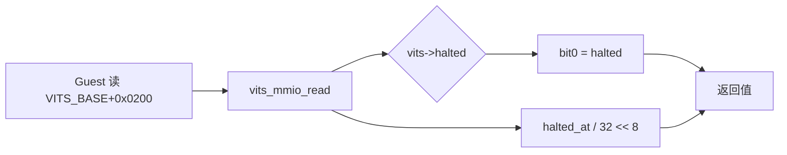
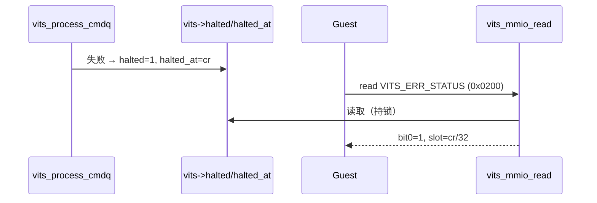

# aVisor Phase 150 详细设计：vITS 软件错误状态寄存器

> 平台：QEMU virt / AArch64 EL2 / GICv3 ITS + vITS
> 前置阶段：Phase 149 MAPTI 重放去重回归
> 本阶段目标：让 Guest 能通过 MMIO 读取最近一次 fail-stop 的状态，而不只依赖串口 WARN。

## 1. 背景

vITS 在命令失败时只打印串口 WARN，Guest 无法得知队列是否停止、停在哪个槽位。GICv3 规范中没有对应 vITS 软件实现的错误寄存器，因此本阶段采用**软件定义的只读寄存器**，并经用户确认接受该偏移。

## 2. 寄存器定义

| 项 | 值 |
|---|---|
| 偏移 | `VITS_ERR_STATUS = 0x0200` |
| 访问 | 只读；写入忽略 |
| bit0 | `halted`：1 表示队列处于 fail-stop |
| bit[31:8] | 失败命令槽位号 = `halted_at / 32` |

选择 `0x0200` 的依据：vITS 窗口为 64KB，已用偏移为 `0x0000`–`0x0090`、`0x0100`–`0x0140`、`0x10040`；`0x0200` 未被占用。`0x0200` 处的其它定义（GICD/GICR `ISPENDR`）属于不同设备窗口，互不影响。

## 3. 架构



## 4. 详细设计

### 4.1 头文件（include/boards/virt/vits.h）

新增 `VITS_ERR_STATUS` 宏，并注明为软件定义。

### 4.2 读路径（hypervisor/boards/virt/vits.c）

在 `vits_mmio_read()` 中新增 `case VITS_ERR_STATUS`：

```c
val = (uint64_t)(vits->halted ? 1 : 0) |
      ((vits->halted_at / VITS_CMD_SIZE) << 8);
```

读取仍在 `vits_lock()` 临界区内，与 `halted`/`halted_at` 的写入串行。

### 4.3 写路径

`vits_mmio_write()` 新增 `case VITS_ERR_STATUS: break;`，避免落入 `unknown write offset` 告警。

### 4.4 不改变的语义

fail-stop 的判定、去重、CREADR 保持、复位清除均不变。本阶段只新增观察面。

## 5. 调用图



## 6. 不变量

| 不变量 | 保证方式 |
|---|---|
| 读值与 halted 状态一致 | 读取在 vITS 锁内 |
| 槽位号 = 失败偏移 / 32 | VITS_CMD_SIZE 为 32 |
| 寄存器只读 | 写路径忽略 |
| 复位后报告未停止 | CBASER 复位清除 halted |

## 7. 验证

- `make -B -f Makefile.virt -j2`：通过；
- `git diff --check`：通过；
- IDE diagnostics（`vits.c`）：无诊断；
- QEMU（35 秒 timeout，退出码 124，属测试窗口结束）：
  - `unknown opcode halted queue, CREADR retained`；
  - `error status reports halt slot`：Guest 读取 `0x0200`，bit0 与槽位号断言通过；
  - 后续 `PASSED! Received vSPI 72`。

验证边界：Guest 只验证了「halt 后报告 halted 与槽位」这一条正向路径。复位后读回 0（未停止）尚未加断言，属于后续可补充的回归。

## 8. 限制

- 寄存器为软件定义，**不是 GICv3 规范寄存器**；真实驱动不会读取它；
- 只记录最近一次 fail-stop 的槽位，不记录失败原因码（无法区分 opcode 未知与 MAPTI 拒绝）；
- 复位后的「未停止」读回尚未覆盖；
- `edu function reset FAILED` 仍在后段出现，属既有问题。

## 9. 文件映射

| 文件 | 职责 |
|---|---|
| `include/boards/virt/vits.h` | `VITS_ERR_STATUS` 宏定义 |
| `hypervisor/boards/virt/vits.c` | 读路径返回状态；写路径忽略 |
| `guests/el1_test/main.c` | 停止后读取并断言该寄存器 |
| 本文件 | 寄存器语义、调用图、验证边界 |

## 10. 总结

Phase 150 为 vITS 增加一个软件定义的只读错误状态寄存器，使 Guest 能在 fail-stop 后通过 MMIO 读取 halted 状态与失败槽位。该寄存器不改变队列语义，仅提供观察面，并已由 QEMU 回归验证。
