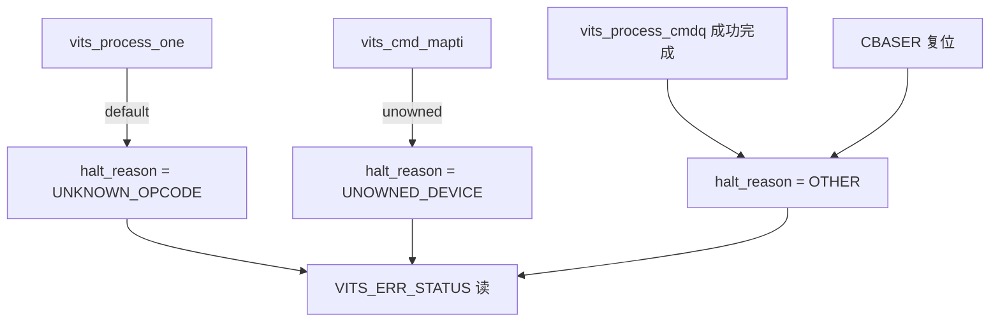
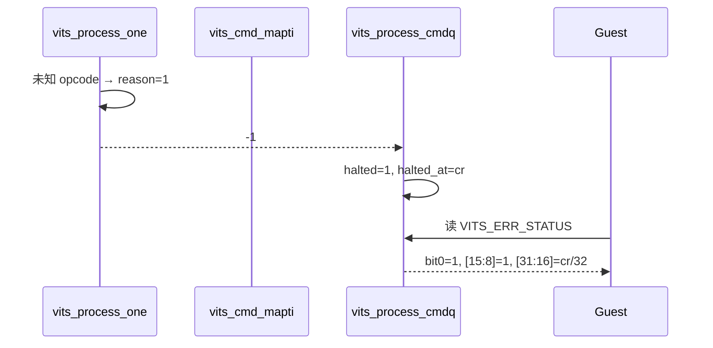

# aVisor Phase 151 详细设计：vITS 错误状态寄存器失败原因码

> 平台：QEMU virt / AArch64 EL2 / GICv3 ITS + vITS
> 前置阶段：Phase 150 vITS 软件错误状态寄存器
> 本阶段目标：让 `VITS_ERR_STATUS` 区分失败原因（未知 opcode / 未拥有 requester / 其它）。

## 1. 背景

Phase 150 的 `VITS_ERR_STATUS` 只能告诉 Guest「队列已停止、停在哪个槽位」，无法区分原因。Guest 仍需解析串口日志才能知道是 opcode 错误还是设备归属错误。

## 2. 寄存器布局（软件定义，只读）

| 位域 | 含义 |
|---|---|
| bit0 | `halted` |
| [15:8] | 失败原因码 `halt_reason` |
| [31:16] | 失败命令槽位号 = `halted_at / 32` |

原因码：

| 常量 | 值 | 来源 |
|---|---|---|
| `VITS_ERR_OTHER` | 0 | 默认值，其它失败与复位后 |
| `VITS_ERR_UNKNOWN_OPCODE` | 1 | `vits_process_one()` 的 default 分支 |
| `VITS_ERR_UNOWNED_DEVICE` | 2 | `vits_cmd_mapti()` 的 requester 拒绝分支 |

槽位字段由 `[31:8]` 扩展到 `[31:16]`。`cmdq_bytes` 最大 1MB（32768 槽位）能被 16 位容纳，不会截断。

## 3. 架构

## 4. 详细设计

### 4.1 状态结构

`struct vits_state` 新增 `uint8_t halt_reason`。`vits_init_vm()` 清零后即为 `VITS_ERR_OTHER`。

### 4.2 设置点

- `vits_process_one()` 的未知 opcode 分支：在 WARN 后设置 `UNKNOWN_OPCODE`；
- `vits_cmd_mapti()` 的未拥有 requester 分支：在 WARN 后设置 `UNOWNED_DEVICE`。

两处都在 `return -1` 之前，且与去重判断并列，不影响告警抑制。

### 4.3 清除点

- `vits_process_cmdq()` 成功推进到 CWRITER 时清为 `OTHER`；
- CBASER 复位时清为 `OTHER`。

### 4.4 读路径

`VITS_ERR_STATUS` 读取时按上述位布局拼装，仍在 `vits_lock()` 内。

## 5. 调用图

## 6. 不变量

| 不变量 | 保证方式 |
|---|---|
| 原因码仅在 halted 时有意义 | 成功推进与复位均清为 OTHER |
| 原因码与失败路径一一对应 | 每个分类点只设置自己的码 |
| 槽位不被截断 | 16 位字段覆盖最大 32768 槽位 |
| 读取原子 | 读路径持 vITS 锁 |

## 7. 验证

- `make -B -f Makefile.virt -j2`：通过；
- `git diff --check`：通过；
- IDE diagnostics（`vits.c`）：无诊断；
- QEMU（35 秒 timeout，退出码 124，属测试窗口结束）：
  - `unknown opcode halted queue, CREADR retained`；
  - `error status reports halt slot`：断言 `[15:8] == UNKNOWN_OPCODE` 与 `[31:16] == slot/32` 通过；
  - 后续 `PASSED! Received vSPI 72`。

## 8. 限制

- 只有两个分类点有具体码；其它失败（`vits_read_cmd` 失败、分配失败、物理 MAPTI 失败）统一为 `OTHER`，未细分；
- `UNOWNED_DEVICE` 分支未被 Guest 回归直接断言（当前回归只走未知 opcode 路径）；
- 原因码为软件定义，不是 GICv3 规范；
- `edu function reset FAILED` 仍在后段出现，属既有问题。

## 9. 文件映射

| 文件 | 职责 |
|---|---|
| `include/boards/virt/vits.h` | 原因码常量、`halt_reason` 字段、寄存器布局注释 |
| `hypervisor/boards/virt/vits.c` | 设置、清除与读路径 |
| `guests/el1_test/main.c` | 原因码与槽位断言 |
| 本文件 | 布局、调用图、不变量与边界 |

## 10. 总结

Phase 151 为错误状态寄存器增加原因码，使 Guest 能区分未知 opcode 与未拥有 requester。未细分的失败统一为 OTHER，并在限制中明确说明。
