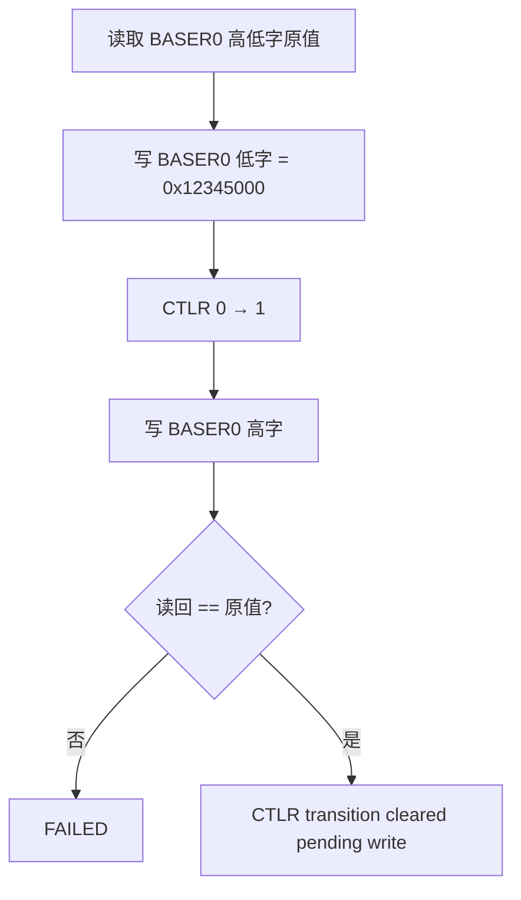
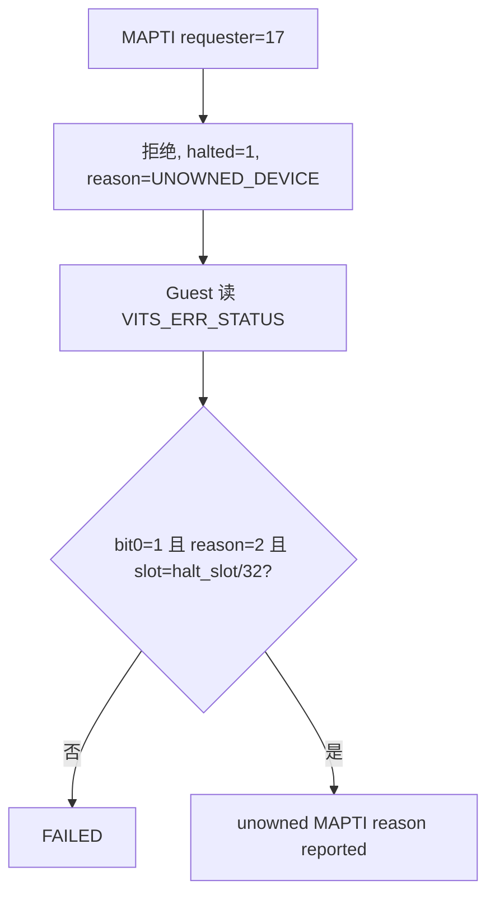
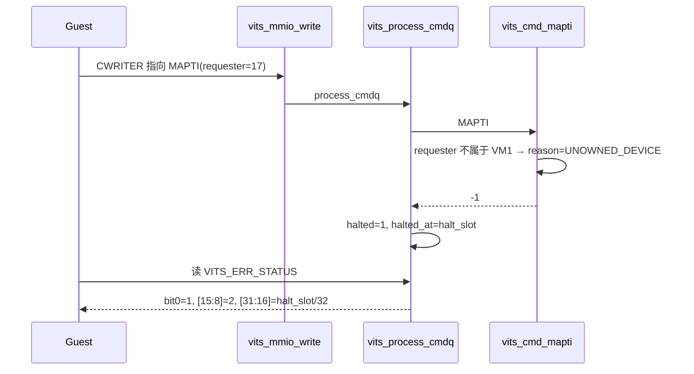

# aVisor Phase 152 详细设计：UNOWNED_DEVICE 原因码回归与 BASER 断言去硬编码

> 平台：QEMU virt / AArch64 EL2 / GICv3 ITS + vITS
> 前置阶段：Phase 151 vITS 错误状态寄存器失败原因码
> 本阶段目标：补齐 `UNOWNED_DEVICE` 原因码的回归，并修复被新代码暴露的硬编码地址断言。

## 1. 背景

Phase 151 引入了三个原因码，但 Guest 回归只走了 `UNKNOWN_OPCODE` 路径，`UNOWNED_DEVICE` 没有任何断言。

本阶段在 MAPTI 未拥有 requester 的停止点读取 `VITS_ERR_STATUS`，断言原因码与槽位。

## 2. 过程中暴露的既有缺陷

加入新断言后，Guest 回归在更早的位置失败：

```
vITS: FAILED (BASER cache survived CTLR transition)
```

排查发现**与本次改动语义无关**，原因是该断言把 BASER0 的期望值硬编码为 `0x40014000`：

```c
if (mmio_read32(VITS_BASE + VITS_BASER(0)) != 0x40014000U || ...)
```

Guest 镜像新增代码后，表基址整体平移 `0x1000`（BASER0 由 `0x...40014000` 变为 `0x...40015000`），硬编码值失效。断言本身是脆弱的：它假定链接布局固定。

## 3. 目标与非目标

目标：

- 在 MAPTI 拒绝停止点断言 `halt_reason == VITS_ERR_UNOWNED_DEVICE`；
- 把 BASER 断言改为「读取切换前原值 → 比较切换后是否不变」，消除对链接地址的依赖。

非目标：修改 hypervisor 的缓存清除行为（Phase 136 的语义是正确的）；修改其它硬编码断言。

## 4. 架构





## 5. 详细设计

### 5.1 BASER 断言去硬编码（guests/el1_test/main.c）

```c
u32 baser0_lo_before = mmio_read32(VITS_BASE + VITS_BASER(0));
u32 baser0_hi_before = mmio_read32(VITS_BASE + VITS_BASER(0) + 4);
mmio_write32(VITS_BASE + VITS_BASER(0), 0x12345000U);
mmio_write32(VITS_BASE + VITS_CTLR, 0);
mmio_write32(VITS_BASE + VITS_CTLR, 1);
mmio_write32(VITS_BASE + VITS_BASER(0) + 4, 0);
if (mmio_read32(VITS_BASE + VITS_BASER(0)) != baser0_lo_before ||
    mmio_read32(VITS_BASE + VITS_BASER(0) + 4) != baser0_hi_before) { ... }
```

验证目标从「等于某个绝对地址」变为「与切换前一致」，语义更准确，也不再随镜像布局漂移。

### 5.2 UNOWNED_DEVICE 断言

在 `unowned MAPTI halted queue, CREADR retained` 之后读取 `VITS_ERR_STATUS`，断言：

- `bit0 == 1`；
- `[15:8] == VITS_ERR_UNOWNED_DEVICE`；
- `[31:16] == halt_slot / 32`。

### 5.3 hypervisor

无改动。

## 6. 调用图



## 7. 不变量

| 不变量 | 保证方式 |
|---|---|
| BASER 断言不依赖链接地址 | 以读回原值为基准 |
| 未拥有 requester 的原因码可观察 | 读寄存器断言 |
| 原因码与槽位同时正确 | 同一次读取内断言 |

## 8. 验证

- `make -B -f Makefile.virt -j2`：通过；
- `git diff --check`：通过；
- QEMU（35 秒 timeout，退出码 124，属测试窗口结束）：
  - `CTLR transition cleared pending register write`；
  - `unowned MAPTI reason reported`（本阶段新增）；
  - `MAPTI replay kept halt point`；
  - `unknown opcode halted queue` / `error status reports halt slot`；
  - `PASSED! Received vSPI 72`。

## 9. 限制

- 硬编码断言可能还有其它实例，本阶段只修了 BASER 一处；
- 原因码仍只有两个分类点，其它失败为 `OTHER`；
- `edu function reset FAILED` 仍在后段出现，属既有问题。

## 10. 文件映射

| 文件 | 职责 |
|---|---|
| `guests/el1_test/main.c` | BASER 断言去硬编码；UNOWNED_DEVICE 断言；原因码宏 |
| 本文件 | 缺陷分析、去硬编码方案、调用图与验证 |

## 11. 总结

Phase 152 补齐了 Phase 151 遗留的 `UNOWNED_DEVICE` 回归，并顺带修复了一个被新代码暴露的脆弱断言：BASER 期望值硬编码为绝对地址，导致 Guest 镜像布局变化时误报失败。修复后断言改为与原值比较，语义更准确。
