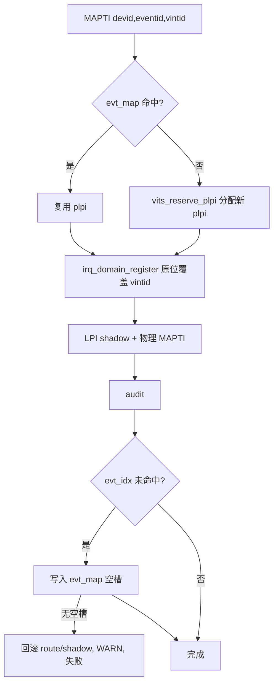
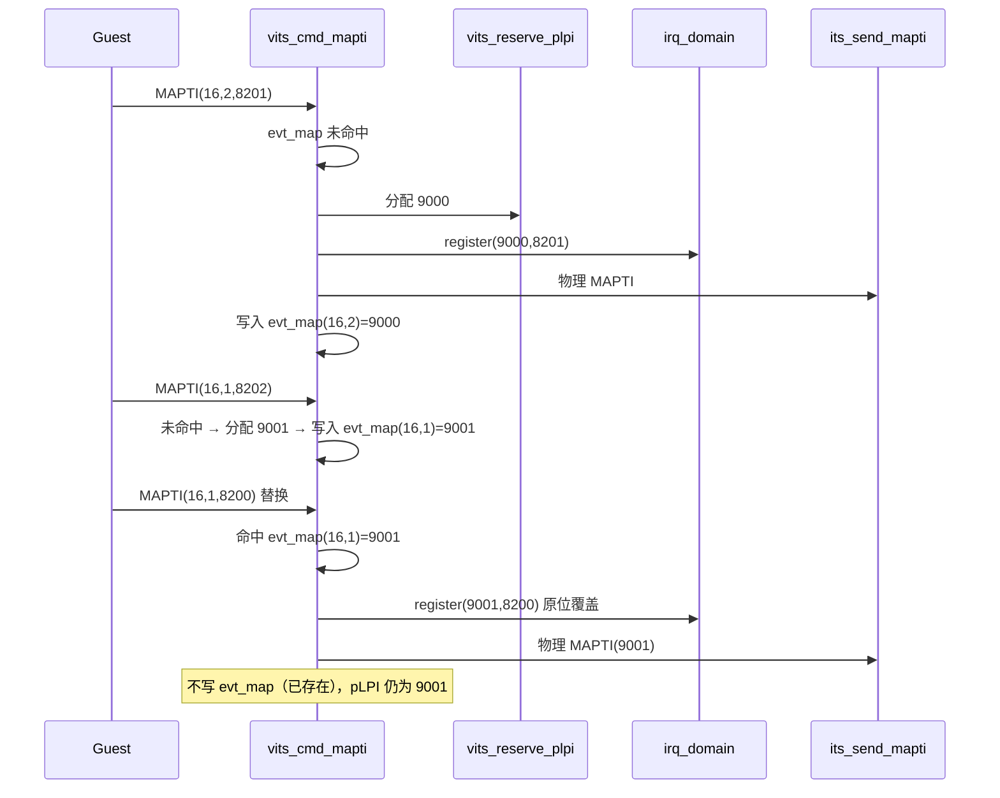

# aVisor Phase 153 详细设计：MAPTI 替换语义与 (devid, eventid) 反查表

> 平台：QEMU virt / AArch64 EL2 / GICv3 ITS + vITS
> 前置阶段：Phase 152 UNOWNED_DEVICE 回归
> 本阶段目标：同一 (DeviceID, EventID) 再次 MAPTI 时替换既有映射并复用 pLPI，消除 pLPI 泄漏。

## 1. 背景与缺陷

Phase 152 之前，`vits_cmd_mapti()` 的 `veventid != 0` 路径每次都调用 `vits_reserve_plpi()` 分配新的物理 LPI，且没有 (devid, eventid) → pLPI 的反向记录。因此：

- 同一事件重复 MAPTI 会不断消耗 pLPI；
- pLPI 池（8192 个）耗尽后，后续 MAPTI 永久失败；
- 与 GICv3 ITS 规范「MAPTI 替换既有 (DeviceID, EventID) 映射」不一致。

`vits_lpi_revoke_*` 仅由设备生命周期路径调用，vITS 命令路径没有回收，因此泄漏确定存在。

## 2. 目标与非目标

目标：

- 新增 per-vITS 反查表 `evt_map[]`，以 (devid, eventid) 查找既有 pLPI；
- 命中时复用该 pLPI，不分配新 pLPI；
- 未命中时分配并写入表项；表满时显式失败并回滚。

非目标：

- 不实现 UNMAPTI / DISCARD 等命令；
- 不回收 pLPI 空洞（单调 cursor 保持不变）；
- 不改变 `irq_domain` 的注册语义。

## 3. 数据结构

```c
#define VITS_EVT_MAP_MAX 64

struct vits_evt_map {
    uint32_t plpi;     /* 0 = 空闲 */
    uint32_t devid;
    uint32_t eventid;
} evt_map[VITS_EVT_MAP_MAX];   /* 位于 struct vits_state 内 */
```

`vits_init_vm()` 使用 `memzero` 整体清零，表项初始为空闲。

## 4. 架构



## 5. 详细设计

### 5.1 查找

遍历 `evt_map`，要求 `plpi != 0` 且 devid、eventid 同时匹配。命中记录 `evt_idx`。

### 5.2 复用路径

命中时 `plpi = evt_map[evt_idx].plpi`，跳过 `vits_reserve_plpi()`。`irq_domain_register()` 对同一 pintid、同一 owner/vmid 是**原位覆盖**（`register_route` 已验证），因此新 vINTID 直接替换旧路由，不产生重复条目。物理 MAPTI 对同一 (devid, eventid) 本身即替换语义。

### 5.3 分配路径与表写入

未命中时分配新 pLPI。成功完成 audit 后，在 `evt_map` 中找空槽写入。若表满：

1. `irq_domain_unregister_owned()` 撤销软件路由；
2. 清除 `lpi_map` shadow；
3. WARN 并返回 -1。

写入发生在 audit 之后，因此表项只记录已发布的映射。

### 5.4 不变量维护

| 不变量 | 保证方式 |
|---|---|
| 同一 (devid, eventid) 至多一个 pLPI | 命中即复用，未命中才写入 |
| 替换不消耗 pLPI | 复用路径不调用 `vits_reserve_plpi` |
| 表项只记录已发布映射 | 写入位于 audit 之后 |
| 表满不产生悬挂路由 | 失败前回滚 route 与 shadow |

## 6. 调用图



## 7. 验证

- `make -B -f Makefile.virt -j2`：通过；
- `git diff --check`：通过；
- IDE diagnostics（`vits.c`）：无诊断；
- QEMU（35 秒 timeout，退出码 124，属测试窗口结束）：

```
MAPTI done: vINTID=8201 -> pLPI=9000   (devid=16 eventid=2 首次分配)
MAPTI done: vINTID=8202 -> pLPI=9001   (devid=16 eventid=1 首次分配)
MAPTI done: vINTID=8200 -> pLPI=9001   (devid=16 eventid=1 替换，复用)
PASSED! Received vSPI 72 (vLPI 8200)
```

替换复用由日志直接证明：第三次同事件 MAPTI 仍为 pLPI 9001，未分配 9002；MSI 按替换后的 vINTID 8200 送达。

## 8. 验证过程中的纠正

起初我以为现有回归已覆盖替换路径，因为 Guest 第 4291 行有一次同参数 MAPTI。核查后发现该行位于 `edu reset` 之后的分支，而 QEMU 中该分支因既有的 `edu function reset FAILED` 而不执行。因此我在主路径新增了「先错后对」的替换用例，才得到实测证据。

## 9. 限制

- 反查表容量 64，满则失败；不做 LRU 或回收；
- pLPI 空洞仍不回收（单调 cursor）；
- 只覆盖 VM1 的 edu 设备路径，未覆盖多设备并发替换；
- 解映射由 DISCARD 承担（`db94bd4` 实现，已由 `main.c` 用例实测：DISCARD 后中断被压制、未拥有 requester 被拒绝）；本阶段未实现 UNMAPTI（未取得可靠规范依据）；
- `edu function reset FAILED` 仍存在。

## 10. 文件映射

| 文件 | 职责 |
|---|---|
| `include/boards/virt/vits.h` | `VITS_EVT_MAP_MAX`、`struct vits_evt_map` |
| `hypervisor/boards/virt/vits.c` | 查找、复用、表项写入与满表回滚 |
| `guests/el1_test/main.c` | 先错后对的替换用例 |
| 本文件 | 替换语义、调用图、验证与纠正 |

## 11. 总结

Phase 153 使 MAPTI 具备替换语义：同一 (DeviceID, EventID) 复用既有 pLPI，pLPI 不再随重复 MAPTI 增长。由于替换路径在原回归中并未真正执行，本阶段补充了专门用例，并以日志实测确认复用与送达。
