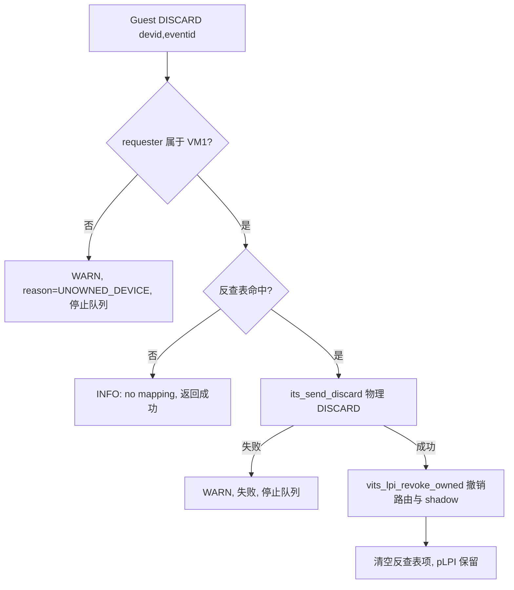
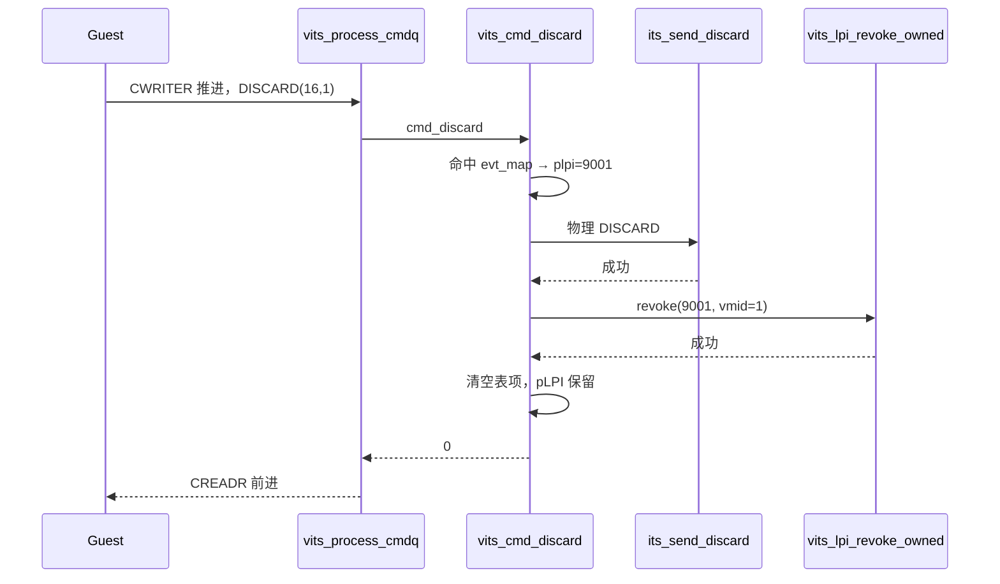

# aVisor Phase 154 详细设计：vITS DISCARD 命令与映射释放

> 平台：QEMU virt / AArch64 EL2 / GICv3 ITS + vITS
> 前置阶段：Phase 153 MAPTI 替换语义与 (devid, eventid) 反查表
> 本阶段目标：实现 GITS DISCARD 命令，释放 (DeviceID, EventID) 映射。

## 1. 背景

Phase 153 引入反查表后，同一 (devid, eventid) 可以替换映射而不泄漏 pLPI。但没有任何途径**删除**映射：反查表项与 `irq_domain` 路由会一直保留，Guest 无法回收事件。

GICv3 规范的 DISCARD（命令码 0x0F）正是为此设计：`dw0[63:32]=DeviceID`，`dw1[31:0]=EventID`。

## 2. 目标与非目标

目标：

- 物理侧新增 `its_send_discard()` 封装 DISCARD 命令；
- vITS 侧识别 Guest 的 DISCARD，清除反查表项、`irq_domain` 路由与 `lpi_map` shadow；
- pLPI **不回收**，保持单调 cursor；
- 未映射的 DISCARD 视为成功（规范允许）。

非目标：

- 不回收 pLPI 号段；
- 不实现 VMOVP / INV 等其它命令；
- 不改变 MAPTI 替换语义。

## 3. 架构



## 4. 详细设计

### 4.1 物理侧（its.c / its.h）

```c
#define ITS_CMD_DISCARD 0x0F

int its_send_discard(unsigned int devid, unsigned int eventid)
{
    return its_send_cmd(ITS_CMD_DISCARD | ((uint64_t)devid << 32),
                        eventid, 0, 0);
}
```

复用 `its_send_cmd()` 的写入 + `dsb` + 轮询 CREADR + 超时锁存逻辑。

### 4.2 vITS 侧（vits.c）

`vits_cmd_discard()`：

1. 校验 requester 归属，不通过则设 `VITS_ERR_UNOWNED_DEVICE` 并返回 -1（沿用 fail-stop 与告警去重）；
2. 遍历 `evt_map` 查找 (vdevid, veventid)；未命中打印 INFO 并返回 0；
3. `its_send_discard()`，失败返回 -1；
4. `vits_lpi_revoke_owned(plpi, vmid)` 撤销 `irq_domain` 路由并清除 `lpi_map` shadow；
5. 清空表项的 plpi/devid/eventid 三个字段。

### 4.3 pLPI 保留策略

pLPI **不**回收到分配池。原因：物理 LPI 配置表项（GICR PROPBASER 指向的字节）已被置为 enabled，若立即复用该号给新事件，在途的旧中断可能被错误投递。保留号段使编号单调，代价是号段会随 DISCARD 次数增长。

### 4.4 命令分派

`vits_process_one()` 新增：

```c
case VITS_CMD_DISCARD:
    if (vits_cmd_discard(vits, cmd, offset) < 0)
        return -1;
    break;
```

## 5. 调用图



## 6. 不变量

| 不变量 | 保证方式 |
|---|---|
| DISCARD 后映射不可再路由 | `irq_domain` 路由与 shadow 同时清除 |
| DISCARD 后中断不送达 | 回归实测（见第 7 节） |
| 重复 DISCARD 幂等 | 未命中返回成功 |
| 失败不留下不一致 | 物理 DISCARD 或 route 撤销失败即返回 -1，由 fail-stop 停止队列 |
| pLPI 不复用 | 回收路径不存在，cursor 单调 |

## 7. 验证

- `make -B -f Makefile.virt -j2`：通过；
- `git diff --check`：通过；
- IDE diagnostics（`vits.c`）：无诊断；
- QEMU（35 秒 timeout，退出码 124，属测试窗口结束）：

```
322: vITS: PASSED! Received vSPI 72 (vLPI 8200)
325: vITS: DISCARD vdevid=16 veventid=1
326: vITS: DISCARD done: devid=16 eventid=1 pLPI=9001 (pLPI retained)
329: vITS: DISCARD suppressed interrupt delivery
```

Guest 回归在 MSI 成功送达后对同一 (16,1) 下发 DISCARD，重新触发 edu 中断，断言 2,000,000 次轮询内**未**收到中断，输出 `DISCARD suppressed interrupt delivery`。

这条验证是端到端的行为证据，不只是日志推断。

## 8. 限制

- 物理 LPI 配置表项未在 DISCARD 时清除（代码推断仍为 enabled，未实测）；由于路由与 shadow 已撤销，在途中断预期被丢弃而非错误注入，但配置表残留需后续核实；
- pLPI 号段不回收，DISCARD 次数多时会持续消耗号段；
- 未覆盖「DISCARD 不存在的映射」的回归（代码返回成功但未实测）；
- 未覆盖 DISCARD 后重新 MAPTI 同一事件（应分配新 pLPI）的回归；
- 反查表容量 64 的上限未变；
- `edu function reset FAILED` 仍存在，本阶段未触及。

## 9. 文件映射

| 文件 | 职责 |
|---|---|
| `include/boards/virt/its.h` | `its_send_discard()` 声明 |
| `hypervisor/boards/virt/its.c` | `ITS_CMD_DISCARD` 宏与命令封装 |
| `include/boards/virt/vits.h` | `VITS_CMD_DISCARD` 宏 |
| `hypervisor/boards/virt/vits.c` | `vits_cmd_discard()` 与命令分派 |
| `guests/el1_test/main.c` | `vits_discard()` 辅助函数与抑制送达回归 |
| 本文件 | 命令语义、策略、调用图与验证 |

## 10. 总结

Phase 154 补齐了映射生命周期的删除端：Guest 可通过 DISCARD 释放 (DeviceID, EventID)，物理 ITS 与软件路由同步清除，pLPI 保留不复用。端到端回归证明了 DISCARD 后中断不再送达。
