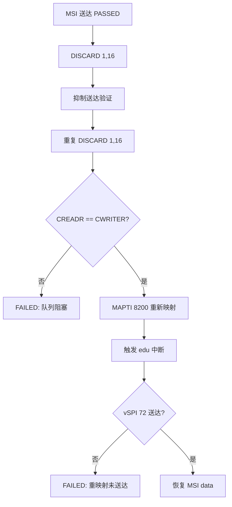
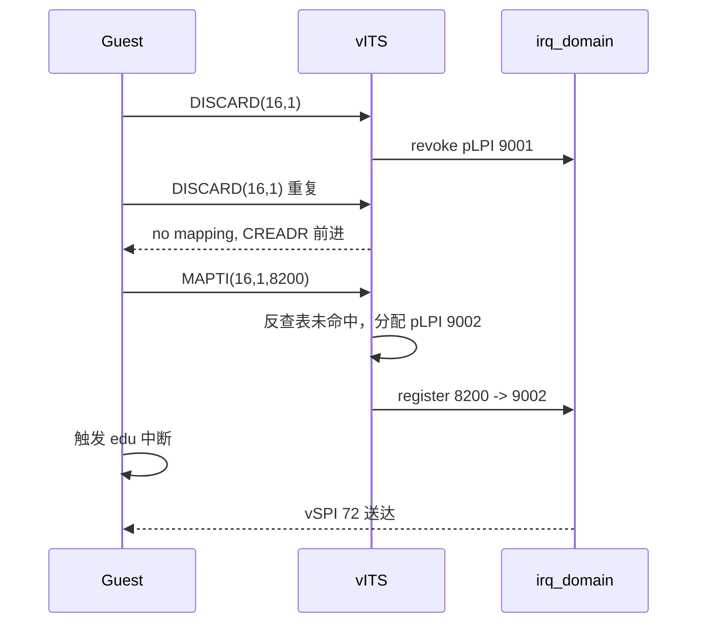

# aVisor Phase 155 详细设计：vITS DISCARD 幂等与重映射回归

> 平台：QEMU virt / AArch64 EL2 / GICv3 ITS + vITS
> 前置阶段：Phase 154 vITS DISCARD 命令与映射释放
> 本阶段目标：补齐 Phase 154 未覆盖的两个回归场景，不修改 hypervisor 实现。

## 1. 背景

Phase 154 实现了 DISCARD 并验证了「DISCARD 后中断不送达」。文档第 8 节列出两项未覆盖：

- 对不存在映射的 DISCARD 是否幂等，且不阻塞队列；
- DISCARD 之后重新 MAPTI 同一事件，是否分配新 pLPI 并恢复送达。

这两项是映射生命周期的正向与边界行为，需要运行时证据而非代码推断。

## 2. 目标与非目标

目标：

- 在 Guest 回归中加入「重复 DISCARD」用例，断言队列排空（CREADR == CWRITER）；
- 加入「DISCARD 后重新 MAPTI」用例，断言中断再次按 vSPI 送达；
- 通过日志确认重映射分配了新 pLPI。

非目标：

- 不修改 `vits.c` / `its.c` 的实现；
- 不回收 pLPI；
- 不处理 `edu function reset FAILED`。

## 3. 架构



## 4. 详细设计

Guest 侧新增两段，位于 `DISCARD suppressed interrupt delivery` 之后、`HVC_PCI_RESET` 之前：

1. 重复 DISCARD：调用 `vits_discard(devid, 1)` 后 `vits_sync()`，读取 `VITS_CREADR` 与 `vits_cwriter` 比较。二者不等即判定队列阻塞。
2. 重映射：调用 `vits_mapti(devid, 1, VITS_TEST_VLPI, 0)`，清 `vits_irq_received`，重新触发 edu 中断并轮询 `vits_irq_intid`，断言等于 `VITS_TEST_VSPI`。

宿主侧实现不变，依赖 Phase 154 的 `evt_map` 清空与 `irq_domain` 撤销。

## 5. 调用图



## 6. 不变量

| 不变量 | 验证 |
|---|---|
| 重复 DISCARD 幂等，不触发 fail-stop | 日志 `DISCARD no mapping`，CREADR 排空 |
| DISCARD 后重映射不复用已撤销的 pLPI | 日志 `MAPTI done: vINTID=8200 -> pLPI=9002` |
| 重映射后中断按新 vINTID 送达 | `remap after DISCARD delivered again` |
| pLPI 单调 | 9001 撤销后分配 9002，号段未回退 |

## 7. 验证

- `make -B -f Makefile.virt -j2`：通过；
- `git diff --check`：通过；
- QEMU（35 秒 timeout，退出码 124，属测试窗口结束）：

```
325: DISCARD vdevid=16 veventid=1
326: DISCARD done: pLPI=9001 (pLPI retained)
329: DISCARD suppressed interrupt delivery
332: DISCARD no mapping for devid=16 eventid=1
335: redundant DISCARD drained cleanly
338: MAPTI done: vINTID=8200 -> pLPI=9002
341: remap after DISCARD delivered again
```

## 8. 限制

- 重映射用例只覆盖 (16,1) 单一事件；多事件并发 DISCARD 未覆盖；
- 未覆盖 DISCARD 对未拥有 requester 的拒绝路径；
- `evt_map` 容量 64 的满表回滚未变；
- pLPI 号段随 DISCARD 次数持续消耗，不回收；
- `edu function reset FAILED` 仍存在，本阶段未触及。

## 9. 文件映射

| 文件 | 职责 |
|---|---|
| `guests/el1_test/main.c` | 重复 DISCARD 与重映射两段回归 |
| 本文件 | 场景、调用图、不变量与验证记录 |

## 10. 总结

Phase 155 用运行时证据补齐了 DISCARD 的两个边界场景：重复 DISCARD 幂等且不阻塞队列；DISCARD 后重映射分配新 pLPI 并恢复送达。宿主实现未改动，仅增强 Guest 回归。
