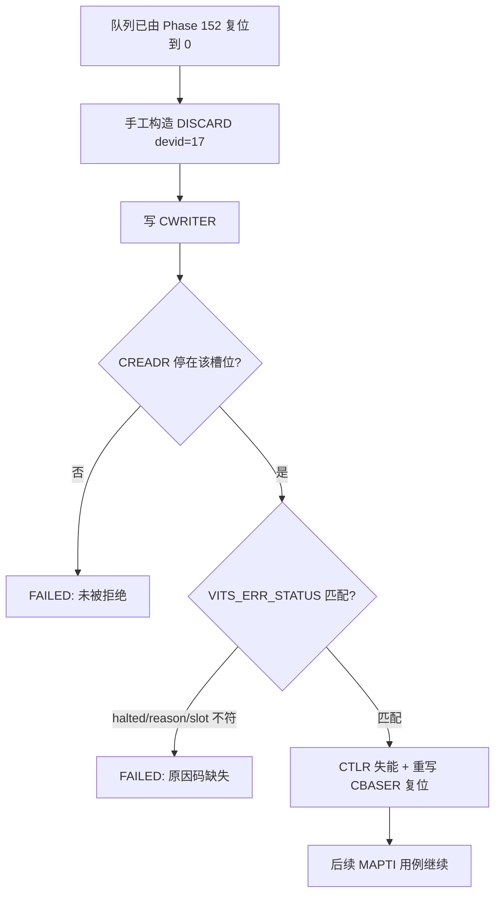
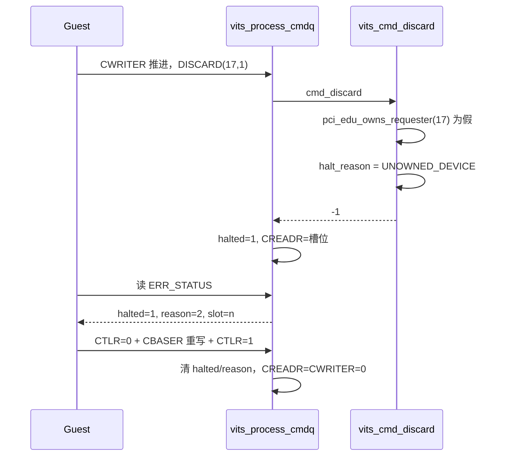

# aVisor Phase 156 详细设计：vITS DISCARD 未拥有设备拒绝回归

> 平台：QEMU virt / AArch64 EL2 / GICv3 ITS + vITS
> 前置阶段：Phase 155 DISCARD 幂等与重映射回归
> 本阶段目标：覆盖 DISCARD 的 UNOWNED_DEVICE 拒绝路径，不修改 hypervisor 实现。

## 1. 背景

Phase 154 为 `vits_cmd_discard()` 写了 requester 归属校验：非 VM1 或非 edu 拥有的 DeviceID 一律拒绝，置 `VITS_ERR_UNOWNED_DEVICE` 并返回 -1，由 fail-stop 保留 CREADR。Phase 155 的文档把这条路径列为未覆盖。

MAPTI 的同类路径在 Phase 152 已有回归，但 DISCARD 是独立分支，不能由 MAPTI 的用例代为证明。

## 2. 目标与非目标

目标：

- 构造 DeviceID 不属于 VM1 的 DISCARD，断言命令被拒绝；
- 断言 `VITS_ERR_STATUS` 上报 `halted=1`、`reason=UNOWNED_DEVICE`、槽位号正确；
- 复位队列，确认拒绝未污染后续用例。

非目标：

- 不修改 `vits.c`；
- 不覆盖「已拥有但事件未映射」的 DISCARD（Phase 155 已覆盖）；
- 不处理 `edu function reset FAILED`。

## 3. 架构



## 4. 详细设计

### 4.1 为什么手工构造槽位

Guest 辅助函数 `vits_discard()` 会在写 CWRITER 后轮询 `CREADR == CWRITER`。fail-stop 下该条件永不成立，函数将耗尽 1,000,000 次轮询并打印 `vITS: command timeout!`。这条日志会与真实超时混淆，因此本用例直接写命令槽与 CWRITER，自行断言 CREADR。

### 4.2 命令内容

```
dw0 = ITS_CMD_DISCARD | (DeviceID << 32)   DeviceID = edu_requester_id + 1
dw1 = 1                                     EventID = 1
dw2 = dw3 = 0
```

`edu_requester_id + 1` 与 Phase 152 未拥有 MAPTI 用例一致，该 DeviceID 已由前面 `vits_mapd()` 尝试注册并被拒绝。

### 4.3 断言

1. `CREADR == dslot_off`：命令未被消费，停在失败槽位；
2. `VITS_ERR_STATUS`：`bit0 == 1`、`[15:8] == VITS_ERR_UNOWNED_DEVICE`、`[31:16] == dslot_off / 32`。

### 4.4 复位

沿用既有模式：`CTLR=0` → 重写 `CBASER` 两半 → `vits_cwriter = 0` → `CTLR=1`，随后断言 `CREADR == CWRITER == 0`。复位同时清除 `halted`/`halt_reason`（Phase 150 的 CBASER 复位清状态逻辑）。

## 5. 调用图



## 6. 不变量

| 不变量 | 验证 |
|---|---|
| 未拥有 requester 的 DISCARD 不被静默消费 | CREADR 停在失败槽位 |
| 拒绝原因可区分 | `[15:8] == VITS_ERR_UNOWNED_DEVICE` |
| 槽位号准确 | `[31:16] == dslot_off / 32` |
| 拒绝不污染后续用例 | 复位后 CREADR/CWRITER 均为 0，后续 MSI 送达 PASSED |
| 不产生误导性超时日志 | 手工写槽位，不经 `vits_discard()` |

## 7. 验证

- `make -B -f Makefile.virt -j2`：通过；
- `git diff --check`：通过；
- QEMU（35 秒 timeout，退出码 124，属测试窗口结束）：

```
305: INFO[1]: vITS: DISCARD vdevid=17 veventid=1
306: WARN[1]: vITS: DISCARD rejected for unowned requester 17
308: [vm1] vITS: unowned DISCARD rejected with UNOWNED_DEVICE
330: [vm1] vITS: PASSED! Received vSPI 72 (vLPI 8200)
337: [vm1] vITS: DISCARD suppressed interrupt delivery
343: [vm1] vITS: redundant DISCARD drained cleanly
349: [vm1] vITS: remap after DISCARD delivered again
```

第 330 行及之后的三行说明：拒绝与复位没有破坏后续 MSI 送达、DISCARD 抑制与重映射。

## 8. 限制

- 只覆盖 VM1 与 edu 的单一 ownership 判定，未覆盖多 VM 争用同一 DeviceID；
- 未覆盖 `vits->vm == NULL` 分支；
- `evt_map` 容量 64 的满表回滚未变；
- 未覆盖 DISCARD 在队列 halt 期间被追加的行为（与 Phase 146 的 MAPTI 版本对称，但未做 DISCARD 专属回归）；
- `edu function reset FAILED` 仍存在，本阶段未触及。

## 9. 文件映射

| 文件 | 职责 |
|---|---|
| `guests/el1_test/main.c` | 未拥有 DISCARD 的手工槽位、原因码断言与复位 |
| 本文件 | 场景、调用图、不变量与验证记录 |

## 10. 总结

Phase 156 补齐了 DISCARD 的拒绝路径回归。DISCARD 的拒绝与 MAPTI 共享 fail-stop 与原因码机制，但分支独立，需要单独证据。实测确认拒绝、原因码、槽位号与复位后的健康状态均符合设计。
