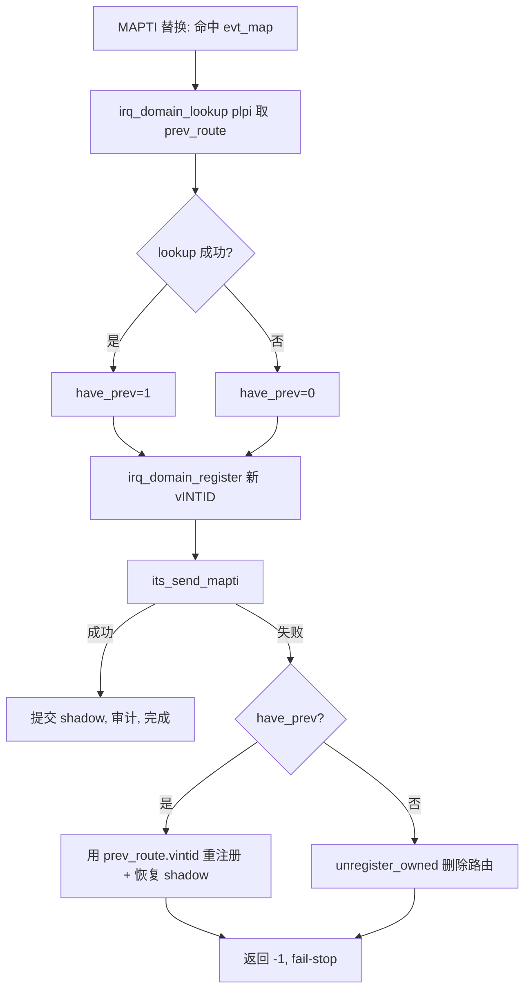
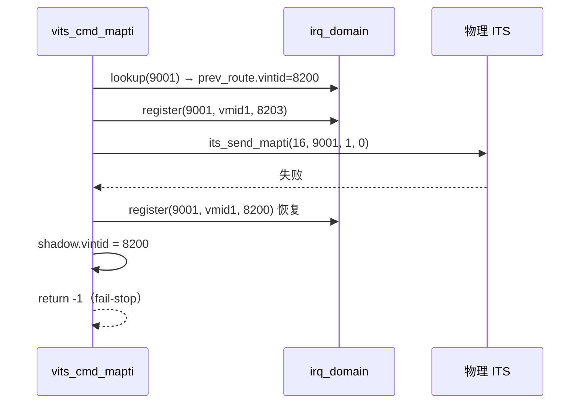

# aVisor Phase 157 详细设计：vITS MAPTI 替换失败时的路由回滚

> 平台：QEMU virt / AArch64 EL2 / GICv3 ITS + vITS
> 前置阶段：Phase 153 MAPTI 替换语义与 (devid, eventid) 反查表
> 本阶段目标：修复替换路径在物理 MAPTI 失败时错误删除已有路由的缺陷。

## 1. 背景

Phase 153 为 MAPTI 引入替换语义：同一 (vdevid, veventid) 复用已有 pLPI，`irq_domain` 与 `lpi_map` shadow 以新 vINTID 原位覆盖。其失败路径沿用新分配版本的写法：

```c
if (its_send_mapti(...) < 0) {
    irq_domain_unregister_owned(plpi, vits->vm->vmid);
    return -1;
}
```

在**新分配**路径上这是对的：映射尚未存在，删除即回滚。
在**替换**路径上这是错的：路由已被覆盖为新 vINTID，`unregister` 会把这条路由整个删除，而反查表项仍指向该 pLPI。

## 2. 缺陷分析

设 (16, 1) 已映射到 pLPI 9001、vINTID 8200，Guest 以 vINTID 8203 替换，且物理 MAPTI 失败：

| 对象 | 替换前 | 失败后（修复前） | 应有状态 |
|---|---|---|---|
| `evt_map` 项 | 9001/16/1 | 9001/16/1 | 9001/16/1 |
| `irq_domain` 路由 | 9001 → 8200 | **不存在** | 9001 → 8200 |
| `lpi_map[9001]` shadow | vmid=1, vintid=8200 | vmid=1, vintid=8203 | vmid=1, vintid=8200 |

后果：Guest 后续再次 MAPTI 同一事件会命中反查表、复用 9001，但此时路由已不存在；`vits_lpi_to_virq()` 查不到路由，中断静默丢弃。该事件从此不可用，且无任何错误上报。

这违反 Phase 153 声明的不变量「失败不破坏已有映射」。

## 3. 目标与非目标

目标：

- 替换路径失败时，恢复替换前的 vINTID（路由与 shadow）；
- 新分配路径保持原有删除语义；
- 不改变成功路径行为。

非目标：

- 不注入物理 ITS 故障（QEMU 下无故障注入手段）；
- 不修改 LPI 配置表字节的写回；
- 不处理 `edu function reset FAILED`。

## 4. 架构



## 5. 详细设计

### 5.1 保存旧路由

在 `irq_domain_register` 覆盖之前读取：

```c
struct irq_route prev_route;
int have_prev = (evt_idx >= 0) &&
                irq_domain_lookup(plpi, &prev_route) == 0;
```

`irq_domain_lookup()` 在 `domain_lock()` 内拷贝匹配路由，返回 0 表示存在。只有替换路径（`evt_idx >= 0`）才可能命中。

### 5.2 失败时恢复

```c
if (its_send_mapti(vdevid, plpi, veventid, vicid) < 0) {
    if (have_prev) {
        irq_domain_register(plpi, vits->vm->vmid, 0, prev_route.vintid);
        lpi_map_acquire();
        lpi_map[plpi - LPI_MAP_BASE].vmid = (uint16_t)vits->vm->vmid;
        lpi_map[plpi - LPI_MAP_BASE].vintid = prev_route.vintid;
        lpi_map_release();
        WARN("vITS: physical MAPTI failed, replacement rolled back to vINTID=%u",
             prev_route.vintid);
    } else {
        irq_domain_unregister_owned(plpi, vits->vm->vmid);
        WARN("vITS: physical MAPTI failed, software route rolled back");
    }
    return -1;
}
```

`irq_domain_register` 对同一 pintid + owner/vmid 是原位覆盖，因此重注册即恢复，不产生重复条目。

### 5.3 为何 LPI 配置字节无需回滚

`*cfg = 0x60 | 0x01` 写入的是 LPI 配置表项的优先级与使能位，不含 vINTID。vINTID 只存在于 `irq_domain` 路由与 `lpi_map` shadow 中，因此恢复这两处即可。

## 6. 调用图



## 7. 不变量

| 不变量 | 保持方式 |
|---|---|
| 失败不破坏已有映射 | 替换失败用 `prev_route.vintid` 恢复 |
| 反查表与路由一致 | 替换失败不改反查表项，路由恢复到原值 |
| 新分配失败不留悬挂路由 | `have_prev == 0` 时仍 `unregister_owned` |
| 成功路径行为不变 | 本次改动只触及失败分支与一次 lookup |

## 8. 验证

- `make -B -f Makefile.virt -j2`：通过；
- `git diff --check`：通过；
- IDE diagnostics（`vits.c`）：无诊断；
- QEMU（35 秒 timeout，退出码 124，属测试窗口结束），非失败路径行为与 Phase 156 一致：

```
314: MAPTI done: vINTID=8201 -> pLPI=9000
318: MAPTI done: vINTID=8202 -> pLPI=9001
322: MAPTI done: vINTID=8200 -> pLPI=9001   ← 替换仍复用
330: PASSED! Received vSPI 72 (vLPI 8200)
334: DISCARD done: pLPI=9001 (pLPI retained)
337: DISCARD suppressed interrupt delivery
340: DISCARD no mapping
343: redundant DISCARD drained cleanly
346: MAPTI done: vINTID=8200 -> pLPI=9002
349: remap after DISCARD delivered again
```

**未验证部分**：`have_prev == 1` 的失败分支在 QEMU 下无法触发，因为 `its_send_mapti()` 只会在命令队列停摆时失败，而该条件需要物理 ITS 故障。本次修复未经运行时证据，仅经代码审查与编译验证。这一点不应被第 8 节的通过项掩盖。

## 9. 限制

- 失败回滚分支无运行时验证；
- 回滚使用 `irq_domain_register` 的返回值被忽略；若重注册失败，路由将缺失，仅 shadow 恢复，仍可能不一致；
- 未处理 `vits_lpi_audit_owned_range` 失败时替换路径的同类问题（该分支目前仍 `unregister_owned`，与本次修复同源缺陷）；
- 物理 LPI 配置字节已按新映射写入，未回滚；
- `edu function reset FAILED` 仍存在。

## 10. 文件映射

| 文件 | 职责 |
|---|---|
| `hypervisor/boards/virt/vits.c` | 保存旧路由、失败分支按路径分流 |
| 本文件 | 缺陷分析、修复方案、不变量与验证边界 |

## 11. 总结

Phase 157 修复了替换路径的失败回滚缺陷：由「删除路由」改为「恢复旧 vINTID」。缺陷会导致一次物理 MAPTI 失败后，(devid, eventid) 永久静默失效。修复仅触及失败分支，成功路径与既有回归行为不变。回滚分支缺少运行时证据，是本阶段的主要验证缺口。
