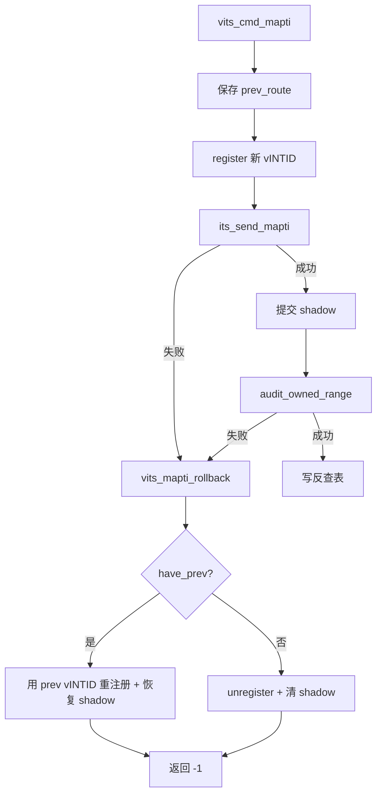

# aVisor Phase 158 详细设计：vITS MAPTI 回滚路径统一

> 平台：QEMU virt / AArch64 EL2 / GICv3 ITS + vITS
> 前置阶段：Phase 157 MAPTI 替换失败路由回滚
> 本阶段目标：把审计失败分支纳入同一回滚语义，消除重复代码与同源缺陷。

## 1. 背景

Phase 157 只修了 `its_send_mapti()` 失败分支：替换路径恢复旧 vINTID，新分配路径删除路由。

但 `vits_cmd_mapti()` 还有第二个失败点——`vits_lpi_audit_owned_range()` 失败。该分支仍是旧写法：

```c
irq_domain_unregister_owned(plpi, vits->vm->vmid);
lpi_map[...].vmid = 0;
lpi_map[...].vintid = 0;
```

在替换路径上，这与会话 157 修复的缺陷完全同源：反查表项仍指向该 pLPI，路由却被删除。

## 2. 缺陷分析

(16, 1) 已映射到 pLPI 9001/vINTID 8200，Guest 以 8203 替换且审计失败：

| 对象 | 替换前 | 审计失败后（修复前） | 应有状态 |
|---|---|---|---|
| `evt_map` | 9001/16/1 | 9001/16/1 | 9001/16/1 |
| 路由 | 9001 → 8200 | **不存在** | 9001 → 8200 |
| shadow | 1/8200 | 0/0 | 1/8200 |

后果与 Phase 157 相同：事件永久静默失效。

## 3. 目标与非目标

目标：

- 抽取 `vits_mapti_rollback()`，统一两个失败点的回滚语义；
- 审计失败时，替换路径恢复旧 vINTID；
- 消除调用点重复的路由/shadow 操作代码。

非目标：

- 不改变成功路径；
- 不回滚物理 ITS 状态（审计失败时物理 MAPTI 已成功，见第 6 节）；
- 不注入故障做运行时验证。

## 4. 架构



## 5. 详细设计

### 5.1 统一辅助函数

```c
static void vits_mapti_rollback(struct vits_state *vits, unsigned int plpi,
                                int have_prev,
                                const struct irq_route *prev_route)
{
    if (have_prev) {
        irq_domain_register(plpi, vits->vm->vmid, 0, prev_route->vintid);
        lpi_map_acquire();
        lpi_map[plpi - LPI_MAP_BASE].vmid = (uint16_t)vits->vm->vmid;
        lpi_map[plpi - LPI_MAP_BASE].vintid = prev_route->vintid;
        lpi_map_release();
        WARN("vITS: MAPTI rolled back replacement to vINTID=%u",
             prev_route->vintid);
        return;
    }

    irq_domain_unregister_owned(plpi, vits->vm->vmid);
    lpi_map_acquire();
    lpi_map[plpi - LPI_MAP_BASE].vmid = 0;
    lpi_map[plpi - LPI_MAP_BASE].vintid = 0;
    lpi_map_release();
    WARN("vITS: MAPTI rolled back new mapping for pLPI %u", plpi);
}
```

日志移入辅助函数，因为两个调用点需要报告的回滚目标不同，只有这里同时握有 `have_prev` 与 `prev_route`。

### 5.2 两个调用点

```c
if (its_send_mapti(vdevid, plpi, veventid, vicid) < 0) {
    vits_mapti_rollback(vits, plpi, have_prev, &prev_route);
    return -1;
}
...
if (vits_lpi_audit_owned_range(plpi, 1, vits->vm->vmid, vintid) < 0) {
    vits_mapti_rollback(vits, plpi, have_prev, &prev_route);
    return -1;
}
```

### 5.3 未改动的分支

「反查表满」分支仍直接 `unregister` + 清 shadow。该分支只在 `evt_idx < 0`（新分配）时可达，替换路径不会进入，因此不存在同源缺陷，不纳入统一。

## 6. 设计边界：物理侧不回滚

审计失败发生在 `its_send_mapti()` **成功之后**。此时物理 ITS 已将 (16, 1) 指向该 pLPI 的新配置。软件回滚只能恢复「pLPI → vINTID」的虚拟视图，无法撤销物理侧已生效的 MAPTI。

实际情况分析：

- 物理侧映射的 DeviceID/EventID → pLPI 未变（替换复用同一 pLPI）；
- 变化的只有 pINTID（vINTID），而它只存在于软件路由与 shadow。

因此物理侧无需回滚：MAPTI 的物理语义对同一 (devid, eventid) → pLPI 是幂等替换，本次审计失败不改变物理结果。

这一点在 Phase 157 未说明，本阶段补齐。

## 7. 不变量

| 不变量 | 保持方式 |
|---|---|
| 两个失败点回滚语义一致 | 共用 `vits_mapti_rollback()` |
| 替换失败不删除仍被反查表引用的路由 | `have_prev` 分支重注册 |
| 新分配失败不留悬挂路由 | `!have_prev` 分支 unregister |
| 成功路径不变 | 辅助函数只在失败分支调用 |

## 8. 验证

- `make -B -f Makefile.virt -j2`：通过，`vits.c` 无警告；
- `git diff --check`：通过；
- IDE diagnostics（`vits.c`）：无诊断；
- QEMU（35 秒 timeout，退出码 124），非失败路径与 Phase 157 完全一致：

```
314: MAPTI done: vINTID=8201 -> pLPI=9000
318: MAPTI done: vINTID=8202 -> pLPI=9001
322: MAPTI done: vINTID=8200 -> pLPI=9001
330: PASSED! Received vSPI 72 (vLPI 8200)
334: DISCARD done: pLPI=9001 (pLPI retained)
337: DISCARD suppressed interrupt delivery
340: DISCARD no mapping
343: redundant DISCARD drained cleanly
346: MAPTI done: vINTID=8200 -> pLPI=9002
349: remap after DISCARD delivered again
```

**未验证**：两个回滚分支在 QEMU 下均不可达，无运行时证据。本阶段与 Phase 157 一样，属于代码正确性修复，仅经审查与编译验证。

## 9. 限制

- 回滚分支无运行时验证；
- `irq_domain_register()` 在回滚中的返回值仍被忽略，重注册失败会导致路由缺失；
- 审计失败后物理 LPI 配置字节保持按新映射写入的状态，未回滚（不影响 vINTID，见第 6 节）；
- 「反查表满」分支未纳入统一，虽当前不可达于替换路径，但与其它分支风格不一致；
- `edu function reset FAILED` 仍存在。

## 10. 文件映射

| 文件 | 职责 |
|---|---|
| `hypervisor/boards/virt/vits.c` | 新增 `vits_mapti_rollback()`，两个失败点改为调用它 |
| 本文件 | 同源缺陷分析、统一方案、物理侧边界与验证缺口 |

## 11. 总结

Phase 158 把审计失败分支纳入与 Phase 157 相同的回滚语义，消除了替换路径上的第二处静默失效缺陷。同时补充说明了物理侧无需回滚的原因：替换复用同一 pLPI，物理映射对 (devid, eventid) → pLPI 是幂等的。
