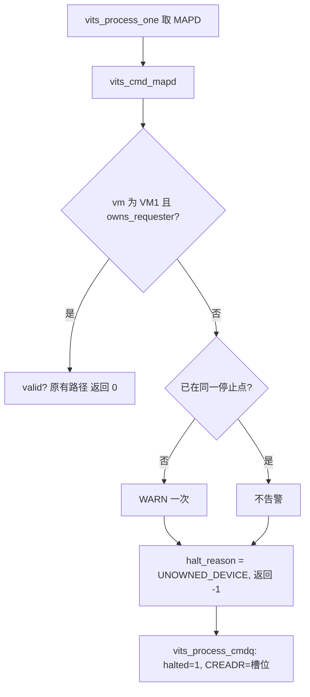
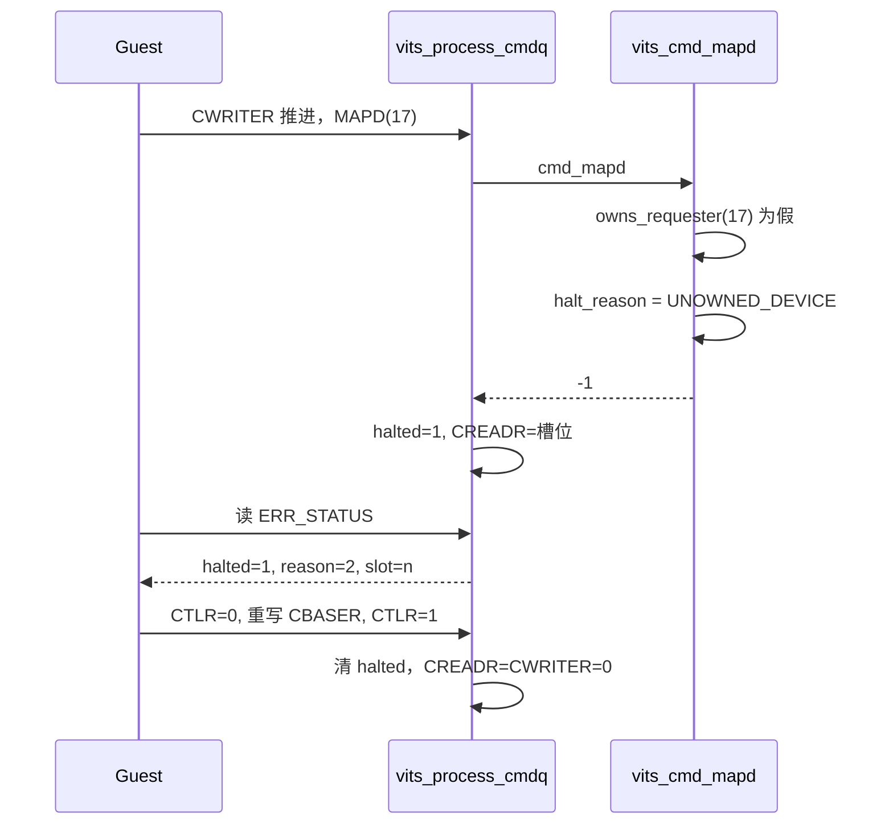

# aVisor Phase 160 详细设计：vITS MAPD 未拥有 requester 纳入 fail-stop

> 平台：QEMU virt / AArch64 EL2 / GICv3 ITS + vITS
> 前置阶段：Phase 159 反查表满回滚风格统一
> 本阶段目标：让 MAPD 对未拥有 requester 的拒绝与 MAPTI/DISCARD 语义一致：停止队列、保留 CREADR、上报原因码。

## 1. 背景

Phase 148–152 为 MAPTI、DISCARD 建立了 fail-stop 与 `VITS_ERR_UNOWNED_DEVICE` 原因码。但 `vits_cmd_mapd()` 长期保持旧写法：

```c
if (!vits->vm || vits->vm->vmid != 1 || !pci_edu_owns_requester(vdevid)) {
    WARN("vITS: MAPD rejected for unowned requester %u", vdevid);
    return;
}
```

它只打印告警并静默返回：

- CREADR 继续前进，队列不停止；
- `VITS_ERR_STATUS` 不报告；
- Guest 无法区分「被拒绝」与「成功」。

这与 MAPTI/DISCARD 的语义不一致，也是 Phase 159 审查时发现的语义缺口。

## 2. 目标与非目标

目标：

- 未拥有 requester 的 MAPD 返回 -1，队列 fail-stop，CREADR 停在该槽位；
- `halt_reason = VITS_ERR_UNOWNED_DEVICE`，`VITS_ERR_STATUS` 可读；
- 同一停止点重复访问不重复告警（沿用 `halted/halted_at` 去重）；
- Guest 回归覆盖该路径，并恢复队列。

非目标：

- 不改变 `valid=0`（MAPD invalid）的行为。该分支仍仅告警并返回成功，属于另一个语义问题，本阶段不扩大范围；
- 不改变已拥有 requester 的 MAPD 行为。

## 3. 设计决策

用户在本阶段前确认：采用 fail-stop（与 MAPTI/DISCARD 一致），而非维持静默拒绝。

理由：静默拒绝让 Guest 无法感知拒绝，而 fail-stop 是本项目已确定的统一语义（Phase 143 用户决策）。

代价：MAPD 被拒绝后，其后的命令在 CTLR 复位前不再执行。这是有意的行为变化。

## 4. 架构



## 5. 详细设计

### 5.1 函数签名

`vits_cmd_mapd()` 由 `void` 改为 `int`，增加 `cmd_offset` 参数，与 `vits_cmd_mapti()`/`vits_cmd_discard()` 保持一致。`vits_process_one()` 检查返回值：

```c
case VITS_CMD_MAPD:
    if (vits_cmd_mapd(vits, cmd, offset) < 0)
        return -1;
    break;
```

### 5.2 拒绝分支

```c
if (!vits->vm || vits->vm->vmid != 1 ||
    !pci_edu_owns_requester(vdevid)) {
    if (!vits->halted || vits->halted_at != cmd_offset)
        WARN("vITS: MAPD rejected for unowned requester %u", vdevid);
    vits->halt_reason = VITS_ERR_UNOWNED_DEVICE;
    return -1;
}
```

去重键与 MAPTI/DISCARD 完全相同。

### 5.3 valid=0 分支

保持 `WARN` 后返回 0（成功），不变。该行为未纳入本阶段语义修复。

## 6. 调用图



## 7. Guest 回归改动

Phase 152 的未拥有 MAPTI 用例依赖一个前置 `vits_mapd(edu+1)`，用来「注册」未拥有设备。该前置调用在 MAPD 现在 fail-stop 后会出现两个问题：

1. `vits_send_cmd()` 的 CREADR 轮询在 halt 下耗尽，打印 `command timeout!`；
2. 队列停在 MAPD 槽位，随后的 MAPTI 槽位永不执行，CREADR 断言失败。

因此改写为：

- 手工写未拥有 MAPD 槽位（与 Phase 156 的 DISCARD 做法一致，避免误导性超时日志）；
- 断言 CREADR 停在该槽位，`VITS_ERR_STATUS` 报告 `UNOWNED_DEVICE`；
- 复位队列，断言 CREADR/CWRITER 归零；
- 随后保留原有未拥有 MAPTI 用例。

## 8. 不变量

| 不变量 | 保持方式 |
|---|---|
| 未拥有 requester 的 MAPD 不被静默消费 | 返回 -1，CREADR 停在槽位 |
| 拒绝原因可观察 | `halt_reason = UNOWNED_DEVICE` |
| 重复访问不重复告警 | `halted/halted_at` 去重 |
| 拒绝后可恢复 | CTLR 复位清 halted |
| 已拥有 MAPD 不变 | 仅拒绝分支改变 |

## 9. 验证

- `make -B -f Makefile.virt -j2`：通过，`vits.c` 无警告；
- `git diff --check`：通过；
- IDE diagnostics（`vits.c`）：无诊断；
- QEMU（35 秒 timeout，退出码 124，属测试窗口结束），精确 grep vITS 段：

```
278: WARN: MAPD rejected for unowned requester 17
280: [vm1] unowned MAPD halted with UNOWNED_DEVICE
288: unowned MAPTI halted queue, CREADR retained
289: unowned MAPTI reason reported
292: MAPTI replay kept halt point
296: queue reset after halt
312: unowned DISCARD rejected with UNOWNED_DEVICE
318-327: MAPTI 正常映射与替换 (pLPI 9001 复用)
334: PASSED! Received vSPI 72 (vLPI 8200)
338-353: DISCARD / 抑制 / 幂等 / 重映射 pLPI 9002
```

未出现 `command timeout!`，也未出现 `FAILED`。

## 10. 限制

- `valid=0` 的 MAPD 仍静默成功，语义未统一，留作后续阶段；
- 未覆盖「MAPD 拒绝后紧跟 halt 期间的其它命令」的专属回归；
- 未覆盖多 VM 争用同一 DeviceID；
- `edu function reset FAILED` 仍存在，edu reset 之后的分支仍未执行；
- 回滚中 `irq_domain_register()` 返回值仍被忽略（经检查，同 owner/vmid 的原位覆盖不会失败，风险可接受，但未加断言）。

## 11. 文件映射

| 文件 | 职责 |
|---|---|
| `hypervisor/boards/virt/vits.c` | `vits_cmd_mapd()` 改为 fail-stop，`vits_process_one()` 检查返回值 |
| `guests/el1_test/main.c` | 未拥有 MAPD 独立用例；未拥有 MAPTI 用例保持原断言 |
| 本文件 | 语义缺口、用户决策、Guest 回归改写原因与验证 |

## 12. 总结

Phase 160 把 MAPD 对未拥有 requester 的拒绝纳入与 MAPTI/DISCARD 一致的 fail-stop 语义。这是一个有意的 Guest 可见行为变化：拒绝不再静默，队列会停止并上报原因码。Guest 回归因此改写为手工写槽位，避免了前置 `vits_mapd()` 在 halt 下的超时与队列阻塞。实测 vITS 全段通过，且没有出现超时日志。
