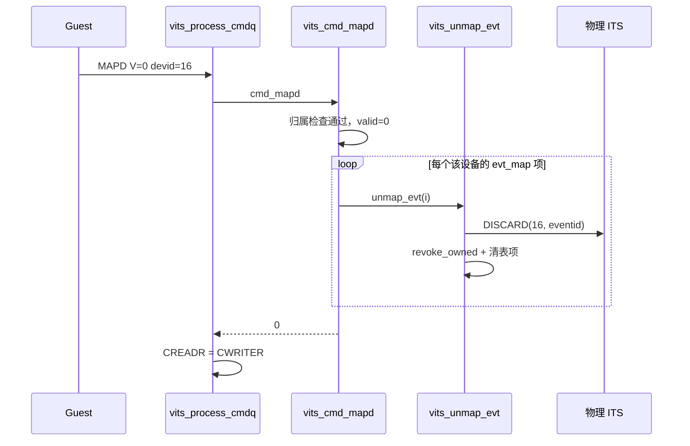

# aVisor Phase 161 详细设计：vITS MAPD V=0 解除设备映射

> 平台：QEMU virt / AArch64 EL2 / GICv3 ITS + vITS
> 前置阶段：Phase 160 MAPD 未拥有 requester 纳入 fail-stop
> 本阶段目标：把 MAPD 的 V=0 由「告警后静默成功」改为真正的解除设备映射。

## 1. 背景

Phase 160 把 MAPD 的未拥有 requester 纳入 fail-stop，但明确留下 `valid=0` 分支未处理：

```c
if (!valid) {
    WARN("vITS: MAPD invalid not supported");
    return 0;
}
```

这段代码的命名本身就有误导：`valid` 是 MAPD 的 V 位（`dw2[63]`），V=0 在 GICv3 中不是「非法命令」，而是**解除设备映射**的标准语义。当前实现打印一条「不支持」的告警却返回成功，Guest 因此认为设备已解绑，而物理 ITS 与该设备的全部事件映射仍然有效。

这是语义不一致：Guest 观察到的状态与设备实际行为相反。

## 2. 缺陷分析

设 devid=16 已建立 eventid=1 → pLPI 9002、eventid=2 → pLPI 9000。Guest 下发 MAPD V=0：

| 对象 | 前 | 修复前（静默成功） | 应有状态 |
|---|---|---|---|
| `evt_map` | 两项有效 | **两项仍在** | 两项清空 |
| `irq_domain` 路由 | 9000/9002 有效 | **仍有效** | 撤销 |
| `lpi_map` shadow | 有效 | **仍有效** | 清空 |
| 物理 ITS 映射 | 有效 | **仍有效** | DISCARD |
| 中断投递 | 正常 | **仍会投递** | 应被抑制 |
| CREADR | — | 前进（报告成功） | 前进（成功） |

后果：Guest 以为设备已解绑，但中断继续按旧映射注入，属于 Guest 可见的错误状态。

## 3. 设计决策

用户在前一阶段被询问时未作出选择，本阶段按推荐方案执行：**实现真正的解除映射**，而非改为拒绝并 fail-stop。

理由：

- V=0 是规范定义的合法命令，拒绝它会让符合规范的 Guest 驱动工作异常；
- 项目已有 DISCARD 的完整撤销路径，复用即可，不需要新的物理命令；
- 拒绝并 fail-stop 只是把「静默错误」变成「显式失败」，仍然不满足规范。

## 4. 架构

```mermaid
flowchart TD
    A[MAPD V=0] --> B[遍历 evt_map 中 devid 匹配的项]
    B --> C{还有项?}
    C -->|否| D[INFO unmapped N event(s) 返回 0]
    C -->|是| E[vits_unmap_evt]
    E --> F[物理 DISCARD]
    F -->|失败| G[返回 -1, fail-stop]
    F -->|成功| H[vits_lpi_revoke_owned 撤销路由与 shadow]
    H -->|失败| G
    H -->|成功| I[清空反查表项]
    I --> B
```

## 5. 详细设计

### 5.1 抽取 `vits_unmap_evt()`

DISCARD 与 MAPD V=0 需要相同的单项撤销语义，因此把原 DISCARD 内联的段落提取为函数：

```c
static int vits_unmap_evt(struct vits_state *vits, int evt_idx)
{
    uint32_t devid = vits->evt_map[evt_idx].devid;
    uint32_t eventid = vits->evt_map[evt_idx].eventid;
    unsigned int plpi = vits->evt_map[evt_idx].plpi;

    if (its_send_discard(devid, eventid) < 0) { ... return -1; }
    if (vits_lpi_revoke_owned(plpi, vits->vm->vmid) < 0) { ... return -1; }

    vits->evt_map[evt_idx].plpi = 0;
    vits->evt_map[evt_idx].devid = 0;
    vits->evt_map[evt_idx].eventid = 0;
    return 0;
}
```

`DISCARD` 改为查表后 `return vits_unmap_evt(vits, evt_idx);`，行为不变。

因为 MAPD 定义在 DISCARD 之前，在「命令处理」段首部加了前向声明。

### 5.2 MAPD V=0 分支

```c
if (!valid) {
    int unmapped = 0;
    for (unsigned int i = 0; i < VITS_EVT_MAP_MAX; i++) {
        if (!vits->evt_map[i].plpi || vits->evt_map[i].devid != vdevid)
            continue;
        if (vits_unmap_evt(vits, (int)i) < 0) {
            WARN("vITS: MAPD V=0 unmap failed for devid=%u", vdevid);
            return -1;
        }
        unmapped++;
    }
    INFO("vITS: MAPD V=0 unmapped %d event(s) for devid=%u", unmapped, vdevid);
    return 0;
}
```

归属检查（`vm == VM1` 且 `owns_requester(vdevid)`）仍在前置完成，未拥有设备的 V=0 继续走 fail-stop，不会触碰任何映射。

### 5.3 部分失败语义

若遍历中途某项撤销失败，函数返回 -1，队列 fail-stop。此时已撤销的项保持撤销，未处理的项保持原状。这是有意选择：已完成的物理 DISCARD 无法回滚，继续处理会在失败后继续修改状态。

## 6. 调用图



## 7. 不变量

| 不变量 | 保持方式 |
|---|---|
| V=0 后该设备无任何有效事件映射 | 遍历清空所有 devid 匹配项 |
| V=0 成功即已真正解绑 | 物理 DISCARD 失败则返回 -1 |
| 未拥有设备的 V=0 不被执行 | 归属检查在 V 位分支之前 |
| 部分失败不留「成功」假象 | 单项失败返回 -1，fail-stop |
| pLPI 不复用 | 沿用 DISCARD 策略 |

## 8. 验证

- `make -B -f Makefile.virt -j2`：通过，`vits.c` 无警告；
- `git diff --check`：通过；
- IDE diagnostics（`vits.c`）：无诊断；
- QEMU（35 秒 timeout，退出码 124）：

```
335: [vm1] PASSED! Received vSPI 72 (vLPI 8200)
339: INFO: unmapped devid=16 eventid=1 pLPI=9001
342: [vm1] DISCARD suppressed interrupt delivery
354: [vm1] remap after DISCARD delivered again
357: INFO: unmapped devid=16 eventid=2 pLPI=9000
358: INFO: unmapped devid=16 eventid=1 pLPI=9002
359: INFO: MAPD V=0 unmapped 2 event(s) for devid=16
361: [vm1] MAPD V=0 unmapped device, interrupt suppressed
```

第 357–358 行是核心证据：V=0 撤销了该设备**所有**事件映射，不止最后建立的那一个。第 361 行证明撤销后中断确实不再注入。

## 9. 限制

- 未覆盖「V=0 在部分撤销失败时」的回归（需注入物理 DISCARD 故障）；
- 未覆盖 V=0 后再次 MAPD V=1 重建映射的回归；
- 未覆盖未拥有设备的 V=0（依赖更前面的归属检查，逻辑上不会执行撤销）；
- 设备映射本身（ITT）未被解除：物理 ITS 的 device table 项仍指向原 ITT，本实现只撤销事件映射。这是既有的简化，本阶段未改变；
- `edu function reset FAILED` 仍存在。

## 10. 文件映射

| 文件 | 职责 |
|---|---|
| `hypervisor/boards/virt/vits.c` | 新增 `vits_unmap_evt()`；DISCARD 与 MAPD V=0 共用；实现 V=0 遍历撤销 |
| `guests/el1_test/main.c` | MAPD V=0 用例：断言队列排空且中断被抑制 |
| 本文件 | 语义缺陷、决策、部分失败语义与验证 |

## 11. 总结

Phase 161 修正了 MAPD V=0 的语义：从「告警后静默成功」改为真正撤销该设备的全部事件映射。实现复用 DISCARD 的撤销路径，抽出 `vits_unmap_evt()` 供两者共用。实测确认两个事件映射（9000、9002）都被撤销，且中断确实被抑制。
