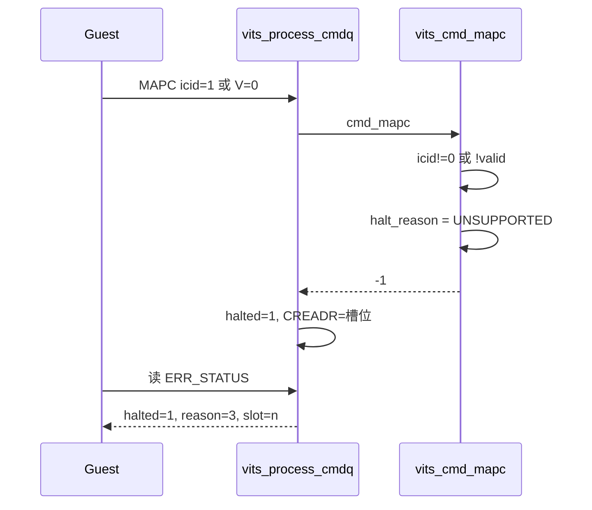

# aVisor Phase 162 详细设计：vITS MAPC 不支持命令纳入 fail-stop

> 平台：QEMU virt / AArch64 EL2 / GICv3 ITS + vITS
> 前置阶段：Phase 161 MAPD V=0 解除设备映射
> 本阶段目标：MAPC 对不支持的 ICID 与解绑（V=0）不再静默成功，改为 fail-stop 并上报原因码。

## 1. 背景

Phase 160 为 MAPD 的未拥有 requester 建立了 fail-stop，Phase 161 修复了 MAPD V=0 的语义。审查时发现 MAPC 存在同构缺陷：

```c
if (icid != 0) {
    WARN("vITS: MAPC only supports ICID 0 (got %u)", icid);
    return;
}
```

问题有两点：

1. `icid != 0` 只打印告警就静默返回，CREADR 继续前进，Guest 无法感知；
2. `valid=0`（解除 collection 映射）完全没有处理，同样静默成功。

## 2. 缺陷分析

| 输入 | 修复前 | 应有行为 |
|---|---|---|
| MAPC icid=0 valid=1 | 成功 | 成功 |
| MAPC icid=1 valid=1 | 告警后静默成功 | 拒绝，fail-stop，`UNSUPPORTED` |
| MAPC icid=0 valid=0 | 静默成功（语义未实现） | 拒绝，fail-stop，`UNSUPPORTED` |

第二行与第三行的后果相同：Guest 认为映射已建立或已解除，实际状态未变。

## 3. 为什么是拒绝而非实现解绑

MAPC 的 collection 0 由 `pci_init` 阶段的 `its_setup_pci_msi()` 固化，VM1 的全部 LPI 都依赖它。若真正解绑 collection 0，所有映射将随之失效，并且没有对应的重建路径。这一代价远大于拒绝。

因此 V=0 与 icid≠0 都选择拒绝，而不是实现。这与 Phase 161 的 MAPD V=0 形成对比：MAPD 的 V=0 有明确可撤销的状态（事件映射），而 MAPC collection 0 没有。

## 4. 设计

### 4.1 原因码

在 `vits.h` 新增：

```c
#define VITS_ERR_UNSUPPORTED      3   /* 命令合法但本实现不支持（如 MAPC 解绑） */
```

Guest 侧宏同步新增 `VITS_ERR_UNSUPPORTED 3`。

### 4.2 MAPC 语义

`vits_cmd_mapc()` 由 `void` 改为 `int`，增加 `cmd_offset` 参数，与其它命令保持一致：

```c
if (icid != 0 || !valid) {
    if (!vits->halted || vits->halted_at != cmd_offset)
        WARN("vITS: MAPC unsupported icid=%u valid=%d", icid, valid);
    vits->halt_reason = VITS_ERR_UNSUPPORTED;
    return -1;
}
return 0;
```

去重键沿用 `halted/halted_at`。`vits_process_one()` 检查返回值并传递失败。

## 5. 调用图



## 6. Guest 侧风险核实

Guest 的 `vits_mapc()` 始终设置 V=1 且只以 icid=0 调用，因此正常初始化路径不会触发该拒绝。这一点通过阅读调用点确认，并由回归的「MAPC 之后的 MAPD/MAPTI/DISCARD 全部通过」间接验证。

## 7. 验证

- `make -B -f Makefile.virt -j2`：退出码 0，`Build complete`；
- `git diff --check`：通过；
- IDE diagnostics（`vits.c`）：无诊断；
- QEMU（35 秒 timeout，退出码 124）：

```
280: [vm1] unowned MAPD halted with UNOWNED_DEVICE
286: WARN: MAPC unsupported icid=1 valid=1
288: [vm1] unsupported MAPC halted with UNSUPPORTED
304: [vm1] queue reset after halt
342: [vm1] PASSED! Received vSPI 72 (vLPI 8200)
349: [vm1] DISCARD suppressed interrupt delivery
361: [vm1] remap after DISCARD delivered again
368: [vm1] MAPD V=0 unmapped device, interrupt suppressed
```

**过程中的错误**：第一次构建失败（`VITS_ERR_UNSUPPORTED undeclared`），因为只在 hypervisor 头文件加了宏，Guest 侧未加。这次失败的 QEMU 输出来自旧镜像，已丢弃。修复后重新构建，`make` 退出码为 0，才以新镜像取得上述结果。

## 8. 限制

- MAPC 的 V=0 与 icid≠0 只拒绝，未实现真正的 collection 解绑（设计上不需要，见第 3 节）；
- 未覆盖 MAPC V=0 的专属回归（只覆盖了 icid=1）；
- 未覆盖 MAPC 拒绝后 halt 期间的其它命令；
- `edu function reset FAILED` 仍存在。

## 9. 文件映射

| 文件 | 职责 |
|---|---|
| `include/boards/virt/vits.h` | 新增 `VITS_ERR_UNSUPPORTED` |
| `hypervisor/boards/virt/vits.c` | MAPC 改为 fail-stop，`vits_process_one()` 检查返回值 |
| `guests/el1_test/main.c` | 新增 `VITS_ERR_UNSUPPORTED` 宏与 MAPC icid=1 回归 |
| 本文件 | 缺陷、拒绝而非实现的决策、验证与构建失败记录 |

## 10. 总结

Phase 162 把 MAPC 的不支持输入从「静默成功」改为显式 fail-stop 并上报 `UNSUPPORTED`，与 MAPD/MAPTI/DISCARD 的语义统一。拒绝 V=0 是有意的设计选择：collection 0 是全局依赖，无法安全撤销。
