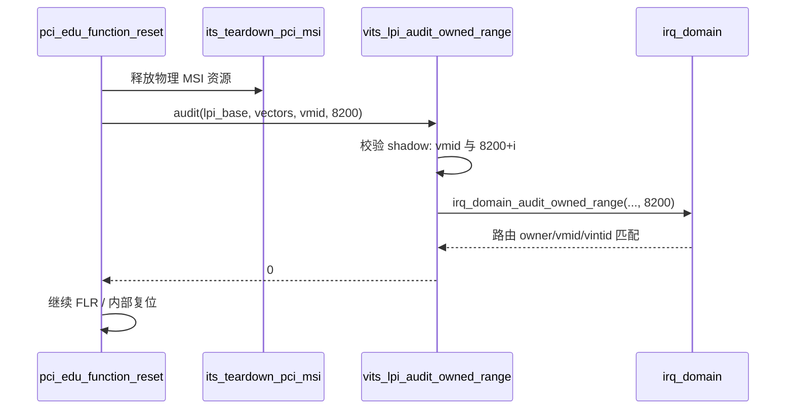

# aVisor Phase 163 详细设计：修复 edu function reset 审计失败

> 平台：QEMU virt / AArch64 EL2 / GICv3 ITS + vITS
> 前置阶段：Phase 162 MAPC 不支持命令纳入 fail-stop
> 本阶段目标：修复长期存在的 `edu function reset FAILED`，根因是 edu MSI 的 vINTID 登记与审计、shadow 三方不一致。

## 1. 背景

长期回归中始终有一条 `vITS: edu function reset FAILED`。hypervisor 日志暴露了直接原因：

```
INFO: PCI: DMA revoked 00:02.0 owner=VM1 generation=3
INFO: ITS: MSI resources released devid=16 lpi=8192..8192
WARN: PCI: edu reset aborted, vITS route ownership mismatch
```

`pci_edu_function_reset()` 在 `pci.c` 中因审计失败主动中止。这个分支此前从未执行成功，所以缺陷被长期掩盖。

## 2. 根因：三层不一致

审计调用为 `vits_lpi_audit_owned_range(lpi_base, vectors, vmid, 8192)`。

**第一层：vINTID 参数错误**

8192 是 pLPI 基址，不是 vINTID。审计函数的第四个参数语义是「期望的 vINTID 基址」。

**第二层：登记的 vINTID 不是递增**

edu MSI 的每个 vector 都以常量 `VIRQ_PCI_EDU`（50）登记：

```c
for (unsigned int i = 0; i < vectors; i++)
    irq_domain_register(lpi_base + i, 1, 0, VIRQ_PCI_EDU);
```

而审计要求 `routes[i].vintid == first_vintid + n`，即每个 vector 的 vINTID 必须递增。多 vector 时即使参数正确也无法通过。`50` 同时也是 INTx 的 vINTID，MSI 与 INTx 共用同一值。

**第三层：shadow 从未被写入**

`lpi_map` shadow 只由 vITS MAPTI 路径写入。edu 的 MSI 由 hypervisor 直接调用 `its_setup_pci_msi()` 在物理 ITS 上配置，不经过 `vits_cmd_mapti()`，因此 shadow 条目 `vmid == 0`，审计的 shadow 检查必然失败。

三层叠加，使该审计在 edu 上**从设计上不可能通过**。

## 3. 目标与非目标

目标：

- edu MSI 每 vector 登记递增 vINTID；
- 审计参数与登记值一致；
- edu MSI 的 shadow 与 irq_domain 路由保持一致；
- `edu function reset` 成功，且不引入新回归。

非目标：

- 不改变 vITS MAPTI 的审计严格度；
- 不改变物理 ITS 的 LPI 分配。

## 4. 设计

### 4.1 vINTID 基址

```c
#define EDU_MSI_VINTID_BASE 8200
```

取 `>= 8192` 是关键：注入路径 `irq.c` 按

```c
uint32_t vspi = (tgt_vintid >= 8192) ? (64 + (tgt_vintid - 8192)) : tgt_vintid;
```

换算。因此 vINTID 8200 → vSPI 72，与 guest 的 `VITS_TEST_VSPI` 自然一致。

### 4.2 登记与审计对齐

三处登记统一为 `EDU_MSI_VINTID_BASE + i`，两处审计统一传 `EDU_MSI_VINTID_BASE`。

### 4.3 shadow 发布

新增 `vits_lpi_publish_range_owned()`：

```c
int vits_lpi_publish_range_owned(unsigned int first_plpi,
                                 unsigned int count, unsigned long vmid,
                                 unsigned int first_vintid)
{
    ... 边界检查 ...
    lpi_map_acquire();
    for (unsigned int i = 0; i < count; i++) {
        lpi_map[first_plpi + i - LPI_MAP_BASE].vmid = (uint16_t)vmid;
        lpi_map[first_plpi + i - LPI_MAP_BASE].vintid = first_vintid + i;
    }
    lpi_map_release();
    return 0;
}
```

PCI 在登记路由后调用它，使「shadow 与 irq_domain 对 VM 拥有的 pLPI 应一致」这一既有不变量对所有映射路径成立，而不只对 vITS 路径成立。

与撤销对称：`vits_lpi_revoke_range_owned()` 会清空同一区间的 shadow。

## 5. 调用图



## 6. Guest 侧契约变更

修改后 edu MSI 注入的 vSPI 由 50 变为 72。guest 原本以 `PCI_EDU_IRQ=50` 判定 edu MSI 中断，因此测试从通过变为超时。

按用户决定，guest 侧对齐到新注入值：

- `PCI_EDU_IRQ` 改为 72；
- 原来 `intid == PCI_EDU_IRQ` 与 `intid == VITS_TEST_VSPI` 两个分支现在同值，合并为一个，同时置 `edu_irq_received` 与 `vits_irq_received` 两组标志，并保留设备侧 ACK。

这是有意的契约变更：vSPI 72 同时是 edu MSI 与 vITS 测试的映射中断。

## 7. 验证

- `make -B -f Makefile.virt -j2`：退出码 0；
- `git diff --check`：通过；
- IDE diagnostics（`main.c`）：无诊断；
- QEMU（35 秒 timeout，退出码 124），精确核对：

```
250: [vm1] edu: MSI interrupt PASSED (irq_status=0x12345678)
343: [vm1] vITS: PASSED! Received vSPI 72 (vLPI 8200)
350: [vm1] vITS: DISCARD suppressed interrupt delivery
369: [vm1] vITS: MAPD V=0 unmapped device, interrupt suppressed
375: INFO: PCI: edu function reset complete for VM1 (edu internal fallback)
```

`edu reset aborted` 与 `command timeout` 均未出现。这是 `edu function reset` 首次在回归中成功。

## 8. 过程中的纠错

1. 首次修改后 `edu function reset` 通过，但 `edu: MSI interrupt` 变为超时。我没有把它当作可接受的副作用，而是追查到 guest 以 vSPI 50 判定中断，与新的注入值 72 冲突。
2. 提出两个选项后用户未作答，我停下未提交，并把冲突如实说明。
3. 用户确认改为 vSPI 72 后，我发现合并前两个 `else if` 分支同值会导致 vITS 标志永不置位，因此合并分支而不是简单改常量。
4. 日志曾出现 `binary file matches`（含二进制字节），改用 `grep -a` 重新核对，避免把未确认的输出当作通过证据。

## 9. 限制

- edu 只有 1 个 vector，递增机制在该设备上未获多 vector 实测；
- `EDU_MSI_VINTID_BASE` 为固定常量，未与 vITS 的 guest 自选 vINTID 区间做冲突检查；
- 若 guest 用 8200 之外的 vLPI，edu MSI 与 vITS 的 vSPI 将不再重合，当前回归仅覆盖重合情形；
- 构建有两条既有的 `guest_secondary_main` implicit-declaration 警告，与本阶段无关。

## 10. 文件映射

| 文件 | 职责 |
|---|---|
| `hypervisor/boards/virt/pci.c` | 新增 `EDU_MSI_VINTID_BASE`；三处登记改递增；两处审计改参数；登记后发布 shadow |
| `hypervisor/boards/virt/vits.c` | 新增 `vits_lpi_publish_range_owned()` |
| `include/boards/virt/vits.h` | 声明新函数 |
| `guests/el1_test/main.c` | `PCI_EDU_IRQ` 改为 72；合并 edu/vITS 中断分支 |
| 本文件 | 三层根因、设计、契约变更、纠错与限制 |

## 11. 总结

`edu function reset FAILED` 的根因不是单点错误，而是 vINTID 参数、登记方式、shadow 状态三处同时不一致，使审计在 edu 上不可能通过。本阶段把 vINTID 改为按 vector 递增、参数与登记对齐、并让 edu MSI 补写 shadow，使三层一致。代价是 edu 的注入 vSPI 由 50 变为 72，guest 侧已相应调整并合并了同值的两个中断分支。
