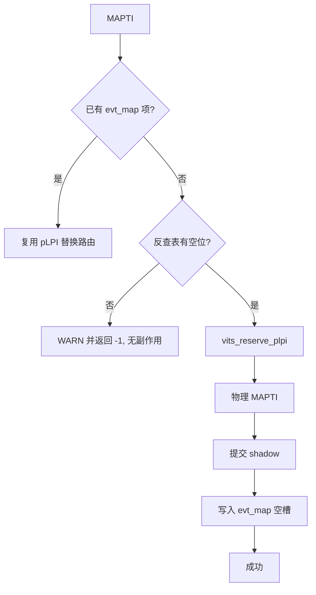

# aVisor Phase 164 详细设计：MAPTI 反查表满时的 pLPI 泄漏防护

> 平台：QEMU virt / AArch64 EL2 / GICv3 ITS + vITS
> 前置阶段：Phase 163 修复 edu function reset 审计失败

## 1. 背景

Phase 159 记录了一个遗留问题：`evt_map[64]` 反查表满时，物理 MAPTI 已经生效，但 vITS 随后才发现无空槽并回滚。

问题在于顺序错误。原流程为：

1. 分配 pLPI（`vits_reserve_plpi`）
2. 下发物理 MAPTI（`its_send_mapti`）
3. 提交 shadow 与路由
4. 查找 `evt_map` 空槽 —— **此处才可能失败**

若在第 4 步失败，物理映射已存在，但反查表没有记录。之后 MAPD V=0 与 DISCARD 都只通过反查表定位映射，因此无法释放它。pLPI 永久泄漏。

## 2. 目标与非目标

目标：

- 反查表满时，在任何副作用（pLPI 分配、物理 MAPTI）发生之前失败。

非目标：

- 不扩大 `evt_map` 容量；
- 不改变替换路径（已有映射时复用 pLPI，不需要新槽位）；
- 不处理 `veventid == 0` 的 edu 特殊分支（见第 6 节）。

## 3. 设计

在新分配路径中，于 `vits_reserve_plpi()` 之前增加前置检查：

```c
int free_slot = -1;
for (unsigned int i = 0; i < VITS_EVT_MAP_MAX; i++) {
    if (!vits->evt_map[i].plpi) { free_slot = (int)i; break; }
}
if (free_slot < 0) {
    WARN("vITS: MAPTI reverse map full for devid=%u eventid=%u", ...);
    return -1;
}
```

替换路径不受影响：它已有 `evt_idx`，不需要新槽位。

末尾原有的表满分支改为不可达断言式处理：前置检查已保证空位，且命令队列单线程处理，因此该分支只在不变量被破坏时触发，此时回滚物理映射并告警。

## 4. 调用图



## 5. 不变量

| 不变量 | 保证方式 |
|---|---|
| 新分配的 pLPI 必然有 evt_map 记录 | 前置检查确认空位，末尾分支不可达 |
| 表满失败时无物理副作用 | 检查在 `vits_reserve_plpi` 与 `its_send_mapti` 之前 |
| 替换路径不需要新槽位 | 替换复用 `evt_idx`，不进入新分配分支 |

## 6. 已识别但未修改：veventid == 0 的 edu 特殊分支

`vits_cmd_mapti()` 中 `veventid == 0` 的分支直接使用 `pci_edu_lpi_base`，不下发物理 MAPTI，也不写 `evt_map`。

我曾考虑删除它，但核查后发现它是**有意的保护**：edu MSI 的 data 为 0，即设备使用 EventID 0；hypervisor 已在 `its_setup_pci_msi()` 中为该事件配置了物理映射。如果 guest 的 MAPTI 对 EventID 0 走标准路径，会覆盖这条已生效的物理映射，破坏 MSI 投递。

因此该分支必须保留。它的已知缺陷是：不写 `evt_map`，所以 MAPD V=0 与 DISCARD 无法撤销 edu 的 EventID 0 映射。这是 edu 生命周期由 PCI 层管理的既有设计，不由 vITS 撤销，本阶段不改变。

## 7. 验证

- `make -B -f Makefile.virt -j2`：退出码 0，无 vits 相关警告；
- `git diff --check`：通过；
- IDE diagnostics（`vits.c`）：无诊断；
- QEMU（35 秒 timeout，退出码 124）：

```
249: [vm1] edu: MSI interrupt PASSED (irq_status=0x12345678)
342: [vm1] vITS: PASSED! Received vSPI 72 (vLPI 8200)
374: INFO: PCI: edu function reset complete for VM1
```

无 `reverse map`、无 `command timeout`、无 `reset aborted`。

**限制**：回归中反查表从未满（最多使用 3 项），因此新增的前置检查分支未被运行时执行，其正确性依赖代码审查。

## 8. 过程中的纠错

1. 第一次替换后删除了末尾表满分支的回滚调用，随后又恢复为断言式处理，因为直接删除会让回滚路径缺失。
2. 替换末尾分支时缩进被破坏，两次修正后确认结构与缩进正确，并通过构建与 diagnostics。
3. 最初计划删除 `veventid == 0` 旁路，核查后发现它保护 edu MSI 的已生效映射，故改为保留并记录。

## 9. 文件映射

| 文件 | 职责 |
|---|---|
| `hypervisor/boards/virt/vits.c` | 新分配路径增加表满前置检查；末尾分支改为断言式处理 |
| 本文件 | 设计、不变量、旁路分析、限制 |

## 10. 总结

本阶段把反查表满的检查前移到任何副作用之前，消除了 pLPI 泄漏的可能。替换路径与 edu 的 EventID 0 保护均未改变。运行时未能触发表满，因此该修复的正确性目前仅由代码审查支撑。
