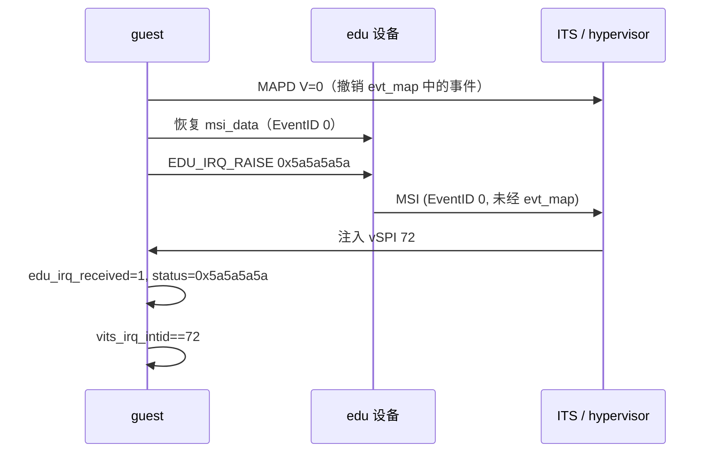

# aVisor Phase 166 详细设计：共享 vSPI 72 回归

> 平台：QEMU virt / AArch64 EL2 / GICv3 ITS + vITS
> 前置阶段：Phase 164 MAPTI 反查表满前置检查、Phase 163 edu function reset 修复

## 1. 背景

Phase 163 把 edu MSI 的 vINTID 改为 `8200 + i`，注入的 vSPI 因此变为 72，与 vITS 测试的 `VITS_TEST_VSPI` 相同。两条中断通路由此**共用 vSPI 72**，但回归中只验证了各自的最终结果，没有验证它们在共享同一号时是否互不失效。

## 2. 目标与非目标

目标：

- 验证 vITS 的 MAPD V=0 撤销设备映射后，edu 原生 MSI 仍能独立送达；
- 验证注入到 guest 的 vSPI 确为 72，即两条通路确实汇聚于同一号。

非目标：

- 不改变 hypervisor 行为；
- 不测试 edu 与 vITS 同时并发触发（回归是顺序的）。

## 3. 设计

在 vITS 段 MAPD V=0 用例之后、`HVC_PCI_RESET` 之前插入一段：

1. 清空 `edu_irq_received`、`edu_irq_status_val`、`vits_irq_received`、`vits_irq_intid`；
2. 恢复 edu 原生 MSI 数据（`msi_data`，EventID 0 映射，不经 `evt_map`）；
3. 写 `EDU_IRQ_RAISE = 0x5a5a5a5a`，等待 `edu_irq_received`；
4. 断言 `edu_irq_status_val == 0x5a5a5a5a`，以精确区分本次触发与历史残留；
5. 断言 `vits_irq_intid == PCI_EDU_IRQ`（72），证明两条路径汇聚于同一 vSPI。

选择 `0x5a5a5a5a` 这一唯一值，是为了让状态断言不会被前序用例的 `0x12345678`、`0xabcdef01` 等值误匹配。

## 4. 调用图



## 5. 验证

- `make -B -f Makefile.virt -j2`：退出码 0；
- `git diff --check`：通过；
- QEMU（35 秒 timeout，退出码 124）：

```
249: [vm1] edu: MSI interrupt PASSED (irq_status=0x12345678)
342: [vm1] vITS: PASSED! Received vSPI 72 (vLPI 8200)
369: [vm1] vITS: edu MSI and vITS share vSPI 72, both paths still deliver
375: INFO: PCI: edu function reset complete for VM1
```

无 `edu MSI lost`、无 `shared vSPI not`、无 `command timeout`。

## 6. 限制

- 回归是顺序执行的，没有覆盖 edu 与 vITS 同时触发时的竞争；
- 共享 vSPI 72 的前提是 `EDU_MSI_VINTID_BASE == 8200` 与 `VITS_TEST_VLPI == 8200`，两者靠常量一致而非运行时校验；
- 该回归证明的是 MAPD V=0 不破坏 edu 原生映射，但 edu 原生 EventID 0 映射在 `evt_map` 之外，这一设计也意味着它不可由 vITS 撤销（Phase 164 已记录）。

## 7. 过程中的核查

- 动手前确认执行顺序：`edu_test()` 先于 `vits_test()`，因此 vITS 不会提前满足 edu 测试，未发现假阳性；
- 状态值选择唯一常量，避免与前序残留值误匹配。

## 8. 文件映射

| 文件 | 职责 |
|---|---|
| `guests/el1_test/main.c` | 在 MAPD V=0 之后新增共享 vSPI 72 回归段 |
| 本文件 | 设计、验证、限制 |

## 9. 总结

本阶段补齐了 Phase 163 引入的共享 vSPI 72 所缺的回归：证明 vITS 的 MAPD V=0 不会破坏 edu 原生 MSI，且两条通路汇聚于同一 vSPI。回归在 QEMU 中通过，无异常输出。
