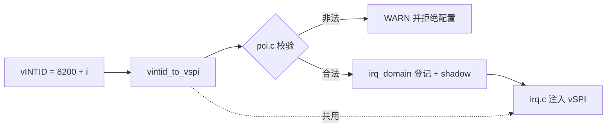

# aVisor Phase 167 详细设计：edu MSI vSPI 运行时校验

> 平台：QEMU virt / AArch64 EL2 / GICv3 ITS + vITS
> 前置阶段：Phase 166 共享 vSPI 72 回归

## 1. 背景

Phase 163 将 edu MSI 的 vINTID 设为 `8200 + i`，注入 vSPI 为 `64 + (vINTID - 8192)`。该映射与 guest 的 `PCI_EDU_IRQ`、`VITS_TEST_VSPI` 共享同一个号（72）。前提仅靠常量取值保证，任一端修改都会静默破坏，Phase 166 已将其记录为限制。

## 2. 目标与非目标

目标：

- 换算规则只有一份，注入路径与 hypervisor 校验共用；
- hypervisor 启动时拒绝落入非法区间的 edu MSI vSPI；
- guest 侧用编译期断言绑定 `PCI_EDU_IRQ` 与 `VITS_TEST_VSPI`。

非目标：

- 不改变注入结果（仍为 72）；
- 不做跨镜像的运行时握手（guest 与 hypervisor 是独立构建的裸机程序）。

## 3. 设计

### 3.1 共享换算函数

`include/boards/virt/vgic.h` 新增 `vintid_to_vspi()`，`irq.c` 注入路径改为调用它。校验与注入使用同一份代码，不存在两份规则漂移的可能。

### 3.2 hypervisor 运行时校验

`pci.c` 在 MSI 路由登记前，对每个 vector 检查换算结果：

```c
if (vspi < 32 || vspi >= 1020 ||
    vspi == VIRQ_VIRTIO_NET || vspi == VIRQ_IVSHMEM ||
    vspi == VIRQ_PCI_EDU) {
    WARN(...);
    return;
}
```

非法时直接返回，不登记路由、不发布 shadow、不使能 MSI，因此不会留下部分配置。

### 3.3 guest 编译期断言

```c
typedef char pci_edu_vspi_matches_vits[(PCI_EDU_IRQ == VITS_TEST_VSPI) ? 1 : -1];
```

负数组长度在两端不一致时产生编译错误。

## 4. 调用图



## 5. 验证

### 5.1 正向

- `make -B -f Makefile.virt -j2`：退出码 0；
- `git diff --check`：通过；
- diagnostics（`pci.c`）：无诊断；
- QEMU（35 秒 timeout，退出码 124）：

```
249: edu: MSI interrupt PASSED (irq_status=0x12345678)
342: vITS: PASSED! Received vSPI 72 (vLPI 8200)
369: vITS: edu MSI and vITS share vSPI 72, both paths still deliver
375: PCI: edu function reset complete for VM1
```

无 `invalid vSPI`。

### 5.2 负面验证（均已还原）

| 注入值 | 结果 | 说明 |
|---|---|---|
| guest `PCI_EDU_IRQ=50` | 编译失败：`size of array ... is negative` | 编译期断言生效 |
| `EDU_MSI_VINTID_BASE=8178` | WARN `maps to invalid vSPI 8178` 并拒绝 | 8178 < 8192 不换算，落在 SPI 下界外 |
| `EDU_MSI_VINTID_BASE=50` | WARN `maps to invalid vSPI 50` 并拒绝 | 原样保留，落入保留区 |

## 6. 诚实的限制

- **「换算后等于 48/49/50」的比较在当前规则下不可达**：`>= 8192` 的 vINTID 换算结果恒 `>= 64`，因此与 `VIRQ_VIRTIO_NET`、`VIRQ_IVSHMEM`、`VIRQ_PCI_EDU` 的相等比较是死代码。它们保留是为了规则未来变化时仍能拦截，但**本阶段没有验证它们被触发**。
- 第三组负面验证（`EDU_MSI_VINTID_BASE=8178`、`50`）拒绝的原因是 SPI 范围，不是保留号冲突。
- 校验只覆盖 edu 的 MSI 路径，没有覆盖 vITS 通过 MAPTI 配置的任意 vINTID。
- guest 断言只检查 edu 与 vITS 两个常量的一致性，不检查 guest 收到的中断号与 hypervisor 的实际注入是否一致；后者由 Phase 166 的运行时回归覆盖。
- 本阶段还暴露了操作失误：负面验证后两次误改 `EDU_MSI_VINTID_BASE`（改为 `9400` 后误改为 `50`），最终均已恢复为 `8200`，并由 Grep 与干净构建确认。

## 7. 文件映射

| 文件 | 职责 |
|---|---|
| `include/boards/virt/vgic.h` | 新增共享换算函数 `vintid_to_vspi()` |
| `hypervisor/boards/virt/irq.c` | 注入路径改用共享换算函数 |
| `hypervisor/boards/virt/pci.c` | MSI 配置前的 vSPI 运行时校验 |
| `guests/el1_test/main.c` | 编译期断言 `PCI_EDU_IRQ == VITS_TEST_VSPI` |
| 本文件 | 设计、负面验证、限制 |

## 8. 总结

本阶段把 edu MSI 的 vSPI 前提从「靠常量碰巧一致」改为三层保障：共享换算函数消除规则重复，hypervisor 在配置前拒绝非法区间，guest 用编译期断言绑定两端常量。负面验证证明编译期断言与 SPI 范围校验确实生效；保留号相等比较在当前规则下不可达，文档已如实注明。
