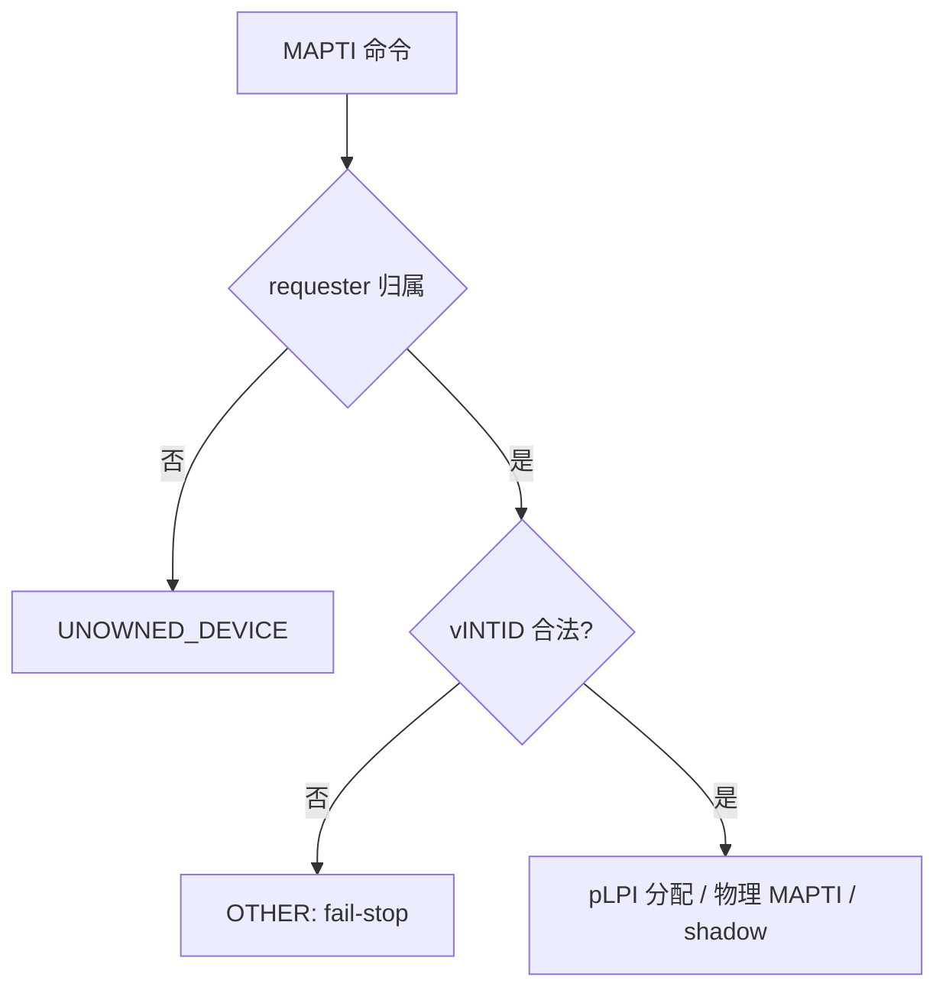

# aVisor Phase 169 详细设计：vITS MAPTI vINTID 运行时校验

> 平台：QEMU virt / AArch64 EL2 / GICv3 ITS + vITS
> 前置阶段：Phase 167 edu MSI vSPI 运行时校验

## 1. 背景

Phase 167 只校验了 hypervisor 自己配置的 edu MSI vINTID。vITS 的 MAPTI 接受 guest 传入的任意 vINTID，没有任何范围检查。

实际后果（代码审查确认）：`irq.c` 注入时若 vINTID < 8192，会原样当作 SPI/SGI 注入。例如 guest 传 `vintid=5` 会注入 SGI，传 `27` 会与 vtimer 冲突。这是 guest 可触发的真实缺陷。

## 2. 目标与非目标

目标：

- MAPTI 拒绝 vINTID < 8192 的映射，且在任何副作用之前失败；
- 换算后 vSPI 超出 SPI 上限时同样拒绝；
- 以 guest 负面用例证明校验真实生效。

非目标：

- 不新增原因码，沿用 `VITS_ERR_OTHER`；
- 不改变合法 vINTID（>= 8192）的注入结果；
- 不校验 vINTID 的唯一性（属于既有的替换语义）。

## 3. 设计

### 3.1 校验位置

`vits_cmd_mapti()` 中，在 `pci_edu_owns_requester` 之后、`veventid == 0` 分支之前。该位置同时覆盖 edu 旁路与标准路径，且早于 pLPI 分配与物理 MAPTI 下发。

### 3.2 校验条件

```c
if (vintid < VITS_LPI_VINTID_BASE ||
    vintid_to_vspi(vintid) >= 1020)
```

- `VITS_LPI_VINTID_BASE`（8192）与 `vintid_to_vspi()` 复用 Phase 167 的共享定义，与注入路径保持同一规则；
- 上限 `1020` 与 `irq.c` 注入规则的 SPI 上界一致。

### 3.3 失败语义

沿用 fail-stop：`halt_reason = VITS_ERR_OTHER`，`WARN` 按 `halted/halted_at` 去重。

## 4. 调用图



## 5. 不变量

| 不变量 | 保证方式 |
|---|---|
| 注入的 vINTID 恒 >= 8192 | MAPTI 入口校验 |
| 非法 MAPTI 无副作用 | 校验早于 `vits_reserve_plpi` 与 `its_send_mapti` |
| 注入规则与校验一致 | 共用 `vintid_to_vspi()` 与 `VITS_LPI_VINTID_BASE` |

## 6. 验证

### 6.1 正向

- `make -B -f Makefile.virt -j2`：退出码 0；
- `git diff --check`：通过；
- diagnostics（`vits.c`）：无诊断；
- QEMU（35 秒 timeout，退出码 124）：

```
249: edu: MSI interrupt PASSED
350: vITS: PASSED! Received vSPI 72 (vLPI 8200)
377: vITS: edu MSI and vITS share vSPI 72, both paths still deliver
383: PCI: edu function reset complete for VM1
```

### 6.2 负面（guest 新增用例，保留为回归）

guest 对 vINTID=5 发 MAPTI，实际日志：

```
294: WARN[1]: vITS: MAPTI invalid vINTID 5
296: [vm1] vITS: invalid vINTID MAPTI halted
```

随后队列复位，正向回归全部通过。

## 7. 限制

- 原因码 `VITS_ERR_OTHER` 语义偏泛，guest 无法区分「非法 vINTID」与「其它失败」；如需精确区分，应另起阶段新增原因码；
- 负面用例只覆盖 vINTID=5（小于下界）。上界分支（换算后 >= 1020）需要 vINTID >= 8192+956 才可达，本阶段未用 guest 运行时验证；
- 校验只约束范围，不检查 vINTID 是否与已有映射冲突。

## 8. 过程中的修正

编辑时一次替换误删了 `if (veventid == 0) {` 这一行，导致 edu 旁路变为无条件执行。我立即补回并重新读取核对结构后才构建。该错误未进入提交。

## 9. 文件映射

| 文件 | 职责 |
|---|---|
| `hypervisor/boards/virt/vits.c` | MAPTI 入口 vINTID 范围校验 |
| `guests/el1_test/main.c` | 非法 vINTID MAPTI 负面回归 |
| 本文件 | 设计、验证、限制 |

## 10. 总结

本阶段补齐了 vITS MAPTI 的 vINTID 范围校验，使其与注入规则一致；校验位于副作用之前，并由 guest 负面用例实测证明会 fail-stop。
