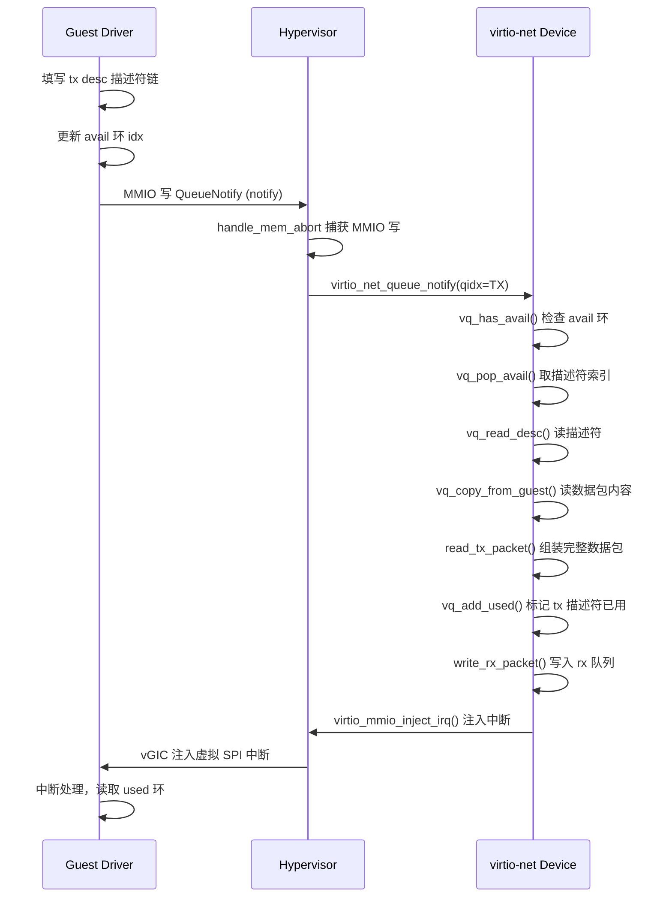
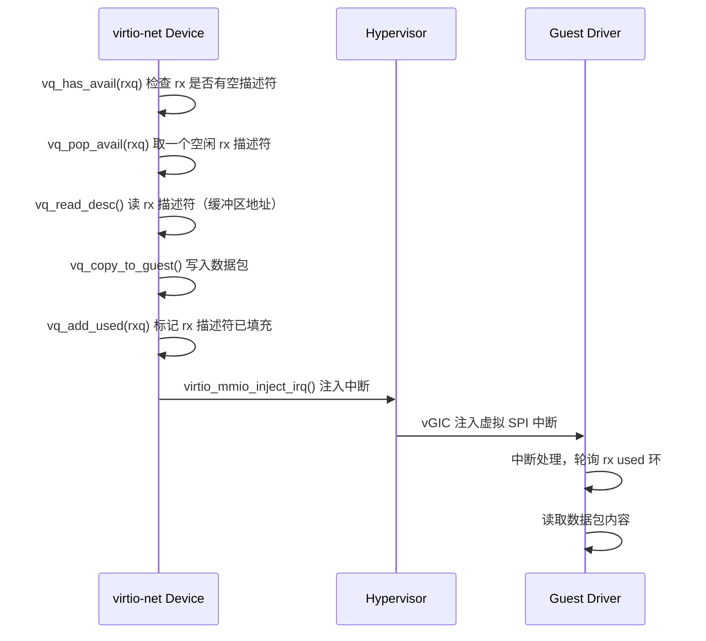
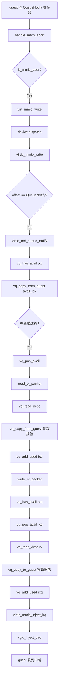

# virtio-net 环回测试修复总结文档

## 1. 概述

本文档记录了 aVisor Hypervisor 中 virtio-net 设备模型的 bug 修复过程。修复前，virtio-net 环回测试因 tx 描述符读取异常和 used 环写入异常而失败；修复后，双 VM 环回测试全部通过。

**测试结果：**
```
[vm1] virtio-net: loopback test PASSED (64 bytes)
[vm2] virtio-net: loopback test PASSED (64 bytes)
```

---

## 2. 软件架构

### 2.1 整体架构

aVisor 是一个 Type-1 Hypervisor，运行在 AArch64 架构上，支持多 VM 并发。virtio-net 设备模型属于 **Phase 4 设备虚拟化** 的一部分。

```
┌─────────────────────────────────────────────────────────────┐
│                        Guest VM (EL1)                       │
│  ┌──────────────┐     ┌──────────────────┐                  │
│  │ virtio-net   │────▶│  virtio driver   │─── MMIO ───┐    │
│  │ 环回测试     │◀───│  (el1_test)      │◀── IRQ ────┤    │
│  └──────────────┘     └──────────────────┘            │    │
└────────────────────────────────────────────────────────│────┘
                                                         │
┌────────────────────────────────────────────────────────│────┐
│                   Hypervisor (EL2)                     │    │
│  ┌───────────────────────────────────────────────────┐ │    │
│  │              MMIO 陷获框架                        │ │    │
│  │  (handle_mem_abort → is_mmio_addr → mmio_write)  │◀┘    │
│  └───────────────────┬───────────────────────────────┘      │
│                      │                                      │
│  ┌───────────────────▼───────────────────────────────┐      │
│  │          virtio_mmio 通用框架                     │      │
│  │  (寄存器模拟 + virtqueue 操作 + 中断注入)         │      │
│  └───────────────────┬───────────────────────────────┘      │
│                      │ virtio_dev_ops                       │
│  ┌───────────────────▼───────────────────────────────┐      │
│  │          virtio-net 设备模型 (环回模式)           │      │
│  │  (read_tx_packet → write_rx_packet)              │      │
│  └───────────────────────────────────────────────────┘      │
│                                                             │
│  ┌─────────────────────┐   ┌──────────────────────────┐    │
│  │  Stage 2 MMU        │   │  vGIC (虚拟中断控制器)   │    │
│  │  (demand paging)    │   │  (vgic_inject_virq)     │    │
│  └─────────────────────┘   └──────────────────────────┘    │
└─────────────────────────────────────────────────────────────┘
```

### 2.2 关键组件

| 组件 | 文件 | 职责 |
|------|------|------|
| MMIO 陷获框架 | `hypervisor/boards/virt/virt_board.c` | 捕获 guest MMIO 访问，分派到对应设备 |
| virtio_mmio 通用框架 | `hypervisor/boards/virt/virtio_mmio.c` | virtio MMIO 寄存器模拟、virtqueue 操作、中断注入 |
| virtio-net 设备模型 | `hypervisor/boards/virt/virt_board.c` | virtio-net 具体设备逻辑（环回模式） |
| Stage 2 MMU | `hypervisor/common/mm.c` | Stage 2 页表管理、demand paging |
| vGIC | `hypervisor/boards/virt/vgic.c` | 虚拟中断控制器，注入虚拟 SPI 中断 |

### 2.3 virtio 设备模型核心抽象

virtio 设备模型分为三层：

1. **控制面（MMIO 寄存器）**：guest 通过 MMIO 读写配置设备（特性协商、队列配置、状态管理）
2. **数据面（virtqueue）**：共享内存中的环形缓冲区，用于批量数据传输
3. **事件通知（中断注入）**：设备有事件时注入虚拟 SPI 中断通知 guest

---

## 3. 详细设计

### 3.1 virtqueue 内存布局

virtqueue (vring) 采用 legacy 布局，按 `align`（默认 4096）对齐：

```
  pfn * PAGE_SIZE         desc_end         avail_end
       │                     │                  │
       ▼                     ▼                  ▼
  ┌────┼─────────────────────┼──────┬───────────┼──────────────────┐
  │ desc 表                  │avail │  padding  │ used 环          │
  │ (16 * num 字节)          │ 环   │           │ (6 + 8*num 字节) │
  └────┴─────────────────────┴──────┴───────────┴──────────────────┘
       ◄──── 16*num ─────►   ◄6+2*num►
       ◄────────────── align_up ──────────────►
                              ◄──────────────── align_up ──────────►
```

以 `VRING_SIZE=16, align=4096` 为例：
- desc 表：offset 0，大小 256 字节
- avail 环：offset 4096（1 页对齐后），大小 38 字节
- used 环：offset 8192（2 页对齐后），大小 134 字节
- **一个 vring 占用 3 个页面**

### 3.2 TX 数据路径（guest → 设备）



### 3.3 RX 数据路径（设备 → guest）



### 3.4 Guest 内存访问（Stage 2 翻译 + Cache 维护）

hypervisor 访问 guest 内存需要经过 Stage 2 地址翻译，同时维护 cache 一致性：

```
  guest IPA
      │
      ▼
  ┌──────────────────────────────────┐
  │   ipa_to_hv_va() 软件 walk       │
  │   Stage 2 页表 → 物理地址 PA     │
  └─────────────────┬────────────────┘
                    │
                    ▼
  ┌──────────────────────────────────┐
  │   TO_VADDR(pa) → HV VA           │
  │   (hypervisor 等值映射)          │
  └─────────────────┬────────────────┘
                    │
                    ▼
  ┌──────────────────────────────────┐
  │   Cache 一致性维护               │
  │   - 读前: dcache_invalidate_range │
  │   - 写后: dcache_clean_range      │
  └─────────────────┬────────────────┘
                    │
                    ▼
               memcpy 操作
```

**关键设计决策：**

1. **主动 demand paging**：`vq_copy_from_guest` / `vq_copy_to_guest` 发现页面未映射时，主动调用 `allocate_task_page()` 分配页面并建立映射。特别是 used 环的页面，guest 从不主动访问（used 环由设备写），必须由 hypervisor 主动分配。

2. **Cache 维护策略**：
   - **读 guest 内存前**：`dcache_invalidate_range` — 丢弃 hypervisor cache 中的旧数据，强制从内存重新加载（guest 以 non-cacheable 写直接到内存）
   - **写 guest 内存后**：`dcache_clean_range` — 把 hypervisor cache 中的数据写回内存（确保 guest 以 non-cacheable 读时能看到最新数据）

### 3.5 vq_add_used 设计（修复后）

`vq_add_used` 采用直接指针操作，避免多次小粒度 MMIO 带来的 cache 一致性问题：

```c
void vq_add_used(dev, vq, desc_idx, len)
{
    // 1. 计算 used 环基地址
    used_base = vq_used_base(vq);

    // 2. 确保页面已映射（主动 demand paging）
    page_va = ipa_to_hv_va(vm, page_ipa);
    if (!page_va)
        page_va = allocate_task_page(vm, page_ipa);

    // 3. 直接指针读写（避免多次小粒度 vq_copy_to_guest）
    idx = *(volatile uint16_t *)(page_va + page_off + 2);
    ring_off = page_off + 4 + (idx % num) * 8;
    *(volatile uint32_t *)(page_va + ring_off) = desc_idx;     // id
    *(volatile uint32_t *)(page_va + ring_off + 4) = len;     // len
    *(volatile uint16_t *)(page_va + page_off + 2) = idx + 1; // idx++

    // 4. 一次 clean 整个页面（确保数据写回内存）
    dcache_clean_range(page_va, PAGE_SIZE);
}
```

### 3.6 vq_read_desc 设计（修复后）

`vq_read_desc` 一次读取整个 16 字节描述符，避免多次小粒度读导致的 cache 一致性问题：

```c
int vq_read_desc(dev, vq, desc_idx, addr_out, len_out, flags_out, next_out)
{
    desc_addr = vq_desc_base(vq) + desc_idx * 16;

    // 一次读 16 字节整个描述符
    struct vring_desc desc;
    if (vq_copy_from_guest(dev, desc_addr, &desc, sizeof(desc)) != 16)
        return -1;

    *addr_out = desc.addr;
    *len_out = desc.len;
    *flags_out = desc.flags;
    *next_out = desc.next;
    return 0;
}
```

---

## 4. 关键函数调用关系

### 4.1 TX 路径完整调用链



### 4.2 核心函数关系表

| 函数 | 文件 | 层级 | 作用 |
|------|------|------|------|
| `handle_mem_abort` | `hypervisor/common/mm.c` | 异常处理 | 处理 Stage 2 数据中止，区分 demand paging 和 MMIO |
| `virtio_mmio_read/write` | `hypervisor/boards/virt/virtio_mmio.c` | 设备框架 | MMIO 寄存器读写分派 |
| `virtio_net_queue_notify` | `hypervisor/boards/virt/virt_board.c` | 设备实现 | tx 队列通知处理（环回核心逻辑） |
| `vq_has_avail` | `hypervisor/boards/virt/virtio_mmio.c` | virtqueue | 检查 avail 环是否有新描述符 |
| `vq_pop_avail` | `hypervisor/boards/virt/virtio_mmio.c` | virtqueue | 从 avail 环取下一个描述符索引 |
| `vq_read_desc` | `hypervisor/boards/virt/virtio_mmio.c` | virtqueue | 读取描述符（一次读 16 字节） |
| `vq_add_used` | `hypervisor/boards/virt/virtio_mmio.c` | virtqueue | 向 used 环添加已处理描述符 |
| `vq_copy_from_guest` | `hypervisor/boards/virt/virtio_mmio.c` | 内存访问 | 从 guest 内存读数据（Stage 2 翻译 + cache invalidate） |
| `vq_copy_to_guest` | `hypervisor/boards/virt/virtio_mmio.c` | 内存访问 | 向 guest 内存写数据（Stage 2 翻译 + cache clean） |
| `ipa_to_hv_va` | `hypervisor/boards/virt/virtio_mmio.c` | 地址翻译 | 软件 walk Stage 2 页表，IPA → HV VA |
| `allocate_task_page` | `hypervisor/common/mm.c` | 内存管理 | 分配物理页 + 建立 Stage 2 映射 |
| `virtio_mmio_inject_irq` | `hypervisor/boards/virt/virtio_mmio.c` | 中断 | 设置中断状态 + 注入虚拟中断 |

---

## 5. 修改的文件与改动说明

### 5.1 文件变更清单

| 文件 | 改动行数 | 主要改动 |
|------|----------|----------|
| `hypervisor/boards/virt/virtio_mmio.c` | +133 / -37 | vq_read_desc 改单次读 16 字节；vq_add_used 重写为直接指针；vq_copy_from/to_guest 加主动 demand paging；cache 维护函数 |
| `guests/el1_test/main.c` | +148 / -0 | Guest MMU 初始化（1GB 等值映射 + Normal cacheable）；virtio-net 环回测试 |
| `include/arch/aarch64/mmu.h` | +1 / -1 | Stage 2 memattr 改为 Normal memory |
| `hypervisor/common/mm.c` | +5 / -0 | demand paging 调试信息（后续可清理） |
| `hypervisor/boards/virt/virt_board.c` | +3 / -0 | write_rx_packet 调试信息已清理 |

### 5.2 核心改动详解

#### 改动 1：vq_read_desc 单次读 16 字节

**问题**：分 4 次读 addr/len/flags/next 时，第一次读到全零。

**原因**：多次小粒度读同一 cache 行不同 offset 时，在 QEMU TCG + 特定 cache 配置下出现一致性问题。

**修复**：改用 `struct vring_desc` 一次读 16 字节整个描述符。

#### 改动 2：vq_add_used 重写为直接指针操作

**问题**：通过 `vq_copy_to_guest` 分 3 次写 id/len/idx 时，guest 端读到的数据不对。

**原因**：used 环页面 guest 从不主动访问，需 hypervisor 主动分配；多次小粒度写配合 cache 维护在 QEMU TCG 下有一致性问题。

**修复**：重写 `vq_add_used`，直接映射整页，用指针一次性操作所有字段，最后一次 `dcache_clean_range` 整个页面。

#### 改动 3：vq_copy_from_guest / vq_copy_to_guest 主动 demand paging

**问题**：used 环页面从未被 guest 访问，Stage 2 无映射，hypervisor 写操作失败。

**原因**：demand paging 依赖 guest 访问触发，但 used 环由设备写入，guest 不会先访问。

**修复**：页面不存在时，主动调用 `allocate_task_page()` 分配物理页并建立 Stage 2 映射。

#### 改动 4：Guest 开启 MMU 和 Cache

**问题**：guest 关闭 MMU 时，内存访问属性与 hypervisor 不一致，增加 cache 一致性难度。

**修复**：guest 初始化时建立 1GB Level 1 block 等值映射（Normal cacheable + Device），开启 SCTLR_EL1.M/C/I。

---

## 6. 踩坑记录

### 坑 1：多次小粒度读 desc 表导致第一次读到零

- **现象**：`vq_read_desc` 分 4 次读 addr/len/flags/next 时，addr=0, len=64（后 3 次正确）
- **验证**：2 次读时 addr=0, len=64；3 次读时全部正确；一次读 16 字节全部正确
- **结论**：QEMU TCG 模式下，连续多次小粒度读同一 cache 行可能出现首读异常
- **规避**：一次读整个 16 字节描述符

### 坑 2：used 环页面未映射导致写操作静默失败

- **现象**：guest 始终收不到 rx 数据包，used_idx 恒为 0
- **根因**：VRING_SIZE=16 + 4KB 对齐 → 一个 vring 占 3 页，used 环在第 3 页；guest 只分配了 2 页，且从不主动访问 used 环；demand paging 不会被触发
- **验证**：guest 第一次读 rx_used 时触发 `demand page: vm=1 ipa=0x40400000`，说明之前未映射
- **修复**：`vq_copy_to_guest` / `vq_copy_from_guest` 中页面不存在时主动分配

### 坑 3：dc ivac 可能丢弃 cache 中未写回的数据

- **现象**：`vq_copy_to_guest` 写数据后，`vq_copy_from_guest` 读回来是零
- **原因**：如果 QEMU TCG 中 `dc cvac` 的模拟与 `dc ivac` 不对称，可能导致 invalidate 后数据丢失
- **规避**：`vq_add_used` 采用直接指针 + 一次整页 clean 的方式，不依赖多次小粒度 cache 操作

### 坑 4：Guest 端 vring 分配不足

- **现象**：guest 的 vring_init 只分配了 `4096 * 2 = 8192` 字节（2 页）
- **问题**：按 4KB 对齐，used 环在第 3 页（offset 0x2000），超出分配范围
- **说明**：由于 Stage 2 demand paging 机制，超出的部分会自动分配新物理页，功能上不受影响，但内存布局不规范
- **建议**：后续按 vring 实际大小分配内存（`vring_size(num, align)`）

---

## 7. 测试验证

### 7.1 测试环境

- **平台**：QEMU 6.x / AArch64 virt 机器
- **配置**：`-M virt,virtualization=on,gic-version=3 -cpu max -smp 1 -m 1G`
- **Hypervisor**：aVisor (EL2)
- **Guest**：el1_test (EL1, 开启 MMU)

### 7.2 测试用例

| 测试项 | 结果 | 说明 |
|--------|------|------|
| VM1 virtio-net 环回 | ✅ PASSED | 64 字节数据包正确回环 |
| VM2 virtio-net 环回 | ✅ PASSED | 64 字节数据包正确回环 |
| ivshmem ping-pong | ⚠️ 部分失败 | VM1 timeout, VM2 正常（与本次修复无关） |

### 7.3 运行命令

```bash
# 构建
make -f Makefile.virt

# 运行
qemu-system-aarch64 -M virt,virtualization=on,gic-version=3 \
    -cpu max -smp 1 -m 1G \
    -kernel bin_virt/kernel8.img \
    -nographic -serial mon:stdio
```

---

## 8. 后续扩展方向

### 8.1 virtio-net 功能增强

| 方向 | 说明 | 优先级 |
|------|------|--------|
| **多描述符链支持** | 当前单描述符测试通过，需验证描述符链（VRING_DESC_F_NEXT） | 高 |
| **GSO / checksum offload** | 支持 VIRTIO_NET_F_GUEST_CSUM、VIRTIO_NET_F_GSO 等特性 | 中 |
| **MAC 地址过滤 / 多队列** | 支持多队列 (VIRTIO_NET_F_MQ)，提升性能 | 中 |
| **virtio-net 现代模式** | 从 legacy MMIO 升级到 modern 模式（packed/notification data） | 低 |

### 8.2 virtio 设备生态扩展

| 方向 | 说明 | 优先级 |
|------|------|--------|
| **virtio-block** | 块设备模型，支持虚拟磁盘 | 高 |
| **virtio-console** | 串口设备，替代当前的 hvc console | 中 |
| **virtio-rng** | 随机数设备 | 低 |
| **virtio-gpu** | 显示设备（复杂度高） | 低 |

### 8.3 性能优化

| 方向 | 说明 | 优先级 |
|------|------|--------|
| **vhost 式加速** | 将数据面 offload 到用户态/另一个核 | 高 |
| **批量通知抑制** | 合并多次 used ring 更新，减少中断注入次数 | 中 |
| **巨页支持** | Stage 2 使用 2MB/1GB 大页，减少 TLB miss | 中 |
| **vring 直接映射** | 避免每次 ipa_to_hv_va 软件 walk，缓存 HV VA | 中 |

### 8.4 可靠性与调试

| 方向 | 说明 | 优先级 |
|------|------|--------|
| **vring 大小规范分配** | 修复 guest 端 vring 只分配 2 页的问题，使用标准 `vring_size()` 计算 | 中 |
| **virtio 跟踪点** | 增加 virtqueue 操作的统计计数（发送/接收/丢弃包数） | 中 |
| **页表一致性验证** | 定期或在 panic 时验证软件 walk 与硬件翻译一致性 | 低 |

### 8.5 架构改进

| 方向 | 说明 | 优先级 |
|------|------|--------|
| **virtio 设备框架重构** | 将 MMIO 通用层与具体设备更清晰地解耦，支持 PCI 传输层 | 中 |
| **设备模型沙箱化** | 设备模型运行在较低特权级或独立地址空间 | 低 |
| **Live Migration 支持** | virtio 设备状态保存/恢复 | 低 |

---

## 9. 附录

### 9.1 关键数据结构

```c
// virtqueue
struct virtqueue {
    uint32_t num;            /* 队列大小 */
    uint32_t pfn;            /* 队列页帧号 (guest IPA / PAGE_SIZE) */
    uint32_t align;          /* 对齐字节数 */
    int      ready;          /* 队列是否就绪 */
    uint16_t last_avail_idx; /* 上次处理到的 avail 索引 */
};

// vring 描述符（16 字节）
struct vring_desc {
    uint64_t addr;   /* guest 物理地址 */
    uint32_t len;    /* 长度 */
    uint16_t flags;  /* VRING_DESC_F_* */
    uint16_t next;   /* 下一个描述符索引 */
};

// vring used 元素（8 字节）
struct vring_used_elem {
    uint32_t id;     /* 描述符索引 */
    uint32_t len;    /* 已用长度 */
};
```

### 9.2 地址空间布局

```
Guest IPA 空间 (VM1 为例):
  0x40000000 - 0x7FFFFFFF  Guest RAM (1GB, demand paging)
  0x0A000000               virtio-net MMIO
  0x0A001000               ivshmem MMIO
  0x0B000000 - 0x0B0FFFFF  ivshmem 共享内存 (1MB)

Hypervisor 虚拟地址空间:
  等值映射 (VA = PA)
  页分配池: 从某个高地址开始
```
